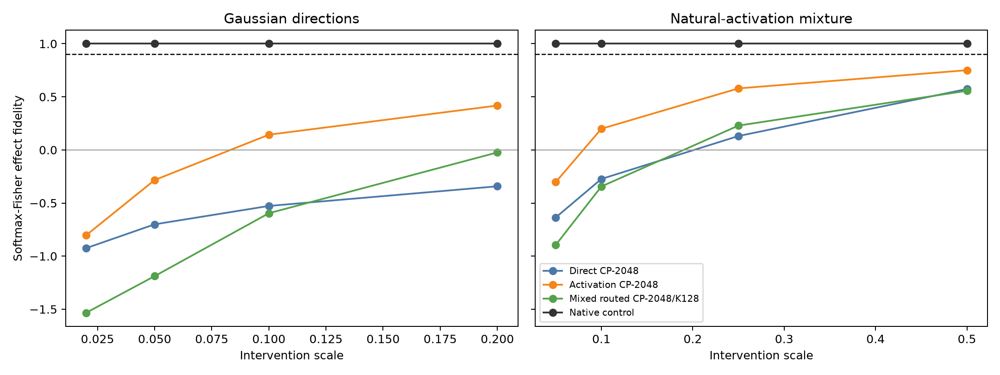

# Causal metric red-team

This is an exploratory analysis run after the confirmatory scorecard. It tests whether the causal ranking is an artifact of one intervention magnitude or one corpus.

## FineWeb scale sweep

| Intervention | Direct CP | Activation CP | Routed CP | Native control |
|---|---:|---:|---:|---:|
| gaussian_0.02 | -0.925 | -0.804 | -1.534 | 1.000 |
| gaussian_0.05 | -0.701 | -0.284 | -1.188 | 1.000 |
| gaussian_0.10 | -0.528 | 0.143 | -0.596 | 1.000 |
| gaussian_0.20 | -0.342 | 0.418 | -0.024 | 1.000 |
| natural_mix_0.05 | -0.636 | -0.304 | -0.895 | 1.000 |
| natural_mix_0.10 | -0.273 | 0.199 | -0.344 | 1.000 |
| natural_mix_0.25 | 0.131 | 0.579 | 0.229 | 1.000 |
| natural_mix_0.50 | 0.574 | 0.751 | 0.557 | 1.000 |

## OOD primary scales

| Corpus/intervention | Direct CP | Activation CP | Routed CP | Native control |
|---|---:|---:|---:|---:|
| wikitext103 / gaussian_0.10 | -0.477 | 0.076 | -0.543 | 1.000 |
| wikitext103 / natural_mix_0.25 | -0.041 | 0.631 | 0.278 | 1.000 |
| tinystories / gaussian_0.10 | -0.377 | 0.137 | -0.578 | 1.000 |
| tinystories / natural_mix_0.25 | 0.131 | 0.559 | 0.171 | 1.000 |

The native-control path must equal 1.0 up to numerical precision. A stable ordering across scales and corpora argues against a threshold artifact; it does not establish fidelity to other intervention families.
