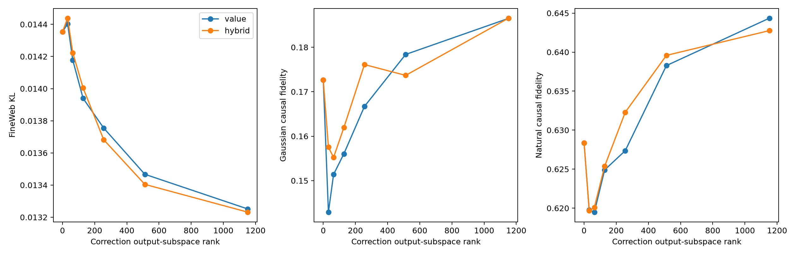

# Basis-invariant correction output subspaces

## Hypotheses

- **H1_value_compact: not supported.**
- **H2_hybrid_causal_compact: not supported.**
- **H3_hybrid_transfer: supported.**
- **H4_hybrid_tradeoff: supported.**

| Basis / rank | FineWeb KL | FW Gaussian | FW natural | Value variance | Hybrid variance |
|---|---:|---:|---:|---:|---:|
| value / 0 | 0.0144 | 0.173 | 0.628 | 0.000 | 0.000 |
| hybrid / 0 | 0.0144 | 0.173 | 0.628 | 0.000 | 0.000 |
| value / 32 | 0.0144 | 0.143 | 0.620 | 0.600 | 0.430 |
| hybrid / 32 | 0.0144 | 0.158 | 0.620 | 0.600 | 0.430 |
| value / 64 | 0.0142 | 0.151 | 0.619 | 0.696 | 0.522 |
| hybrid / 64 | 0.0142 | 0.155 | 0.620 | 0.696 | 0.522 |
| value / 128 | 0.0139 | 0.156 | 0.625 | 0.797 | 0.636 |
| hybrid / 128 | 0.0140 | 0.162 | 0.625 | 0.797 | 0.636 |
| value / 256 | 0.0138 | 0.167 | 0.627 | 0.894 | 0.771 |
| hybrid / 256 | 0.0137 | 0.176 | 0.632 | 0.894 | 0.771 |
| value / 512 | 0.0135 | 0.178 | 0.638 | 0.963 | 0.901 |
| hybrid / 512 | 0.0134 | 0.174 | 0.640 | 0.963 | 0.901 |
| value / 1152 | 0.0133 | 0.187 | 0.644 | 1.000 | 1.000 |
| hybrid / 1152 | 0.0132 | 0.187 | 0.643 | 1.000 | 1.000 |

The subspace is in the 1,152-dimensional layer-write space and is invariant to permutation/rescaling of CP terms. It is a descriptive projection: both parent CP models are still evaluated, so this is not yet a runtime compression result.

Value PCA fits natural correction writes. Hybrid PCA equally weights normalized covariance from values, Gaussian tangents, and natural tangents.

Raw results: `correction_subspace_results.json`.
