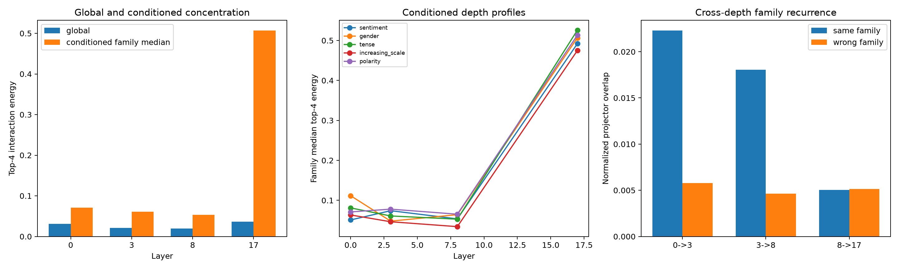

# Semantic-conditioned tensor spikes across depth

The same frozen semantic edits define output-4 family spaces at layers 0, 3, 8, and 17. Each is rotated by its layer's exact tensor-Frobenius geometry. Conditioned spectra are compared with equally canonicalized random output-4 spaces plus sign and coefficient-pairing nulls. Global full-tensor spectra and cross-layer family-projector recurrence are reported separately.

## Locked hypotheses

- **D1_canonicalization_is_exact_at_every_depth: supported.**
- **D2_conditioning_enriches_low_rank_forms_at_every_depth: supported.**
- **D3_conditioned_axes_survive_two_nulls_at_every_depth: not supported.**
- **D4_strict_powerlaw_spikes_have_low_recall_at_every_depth: not supported.**
- **D5_family_output_spaces_recur_across_depth: not supported.**
- **D6_global_spikes_align_more_with_families_late: supported.**
- **D7_late_global_concentration_implies_late_conditioned_concentration: supported.**
- **D8_family_spaces_are_not_global_spike_spaces: not supported.**
- **D9_layer3_replicates_prior_concentration: supported.**

| Layer | Global top-4 | Conditioned median top-4 | Random 95th | Families above random | Median family/global overlap | Strict conditioned axes |
|---:|---:|---:|---:|---:|---:|---:|
| 0 | 0.031 | 0.071 | 0.039 | 5/5 | 0.043 | 1/20 |
| 3 | 0.021 | 0.061 | 0.027 | 5/5 | 0.036 | 2/20 |
| 8 | 0.020 | 0.054 | 0.028 | 5/5 | 0.035 | 1/20 |
| 17 | 0.037 | 0.507 | 0.043 | 5/5 | 0.840 | 19/20 |

| Adjacent layers | Same-family overlap | Wrong-family overlap | Gap |
|---|---:|---:|---:|
| 0->3 | 0.022 | 0.006 | 0.017 |
| 3->8 | 0.018 | 0.005 | 0.013 |
| 8->17 | 0.005 | 0.005 | -0.000 |

Global concentration, conditioned concentration, and cross-depth recurrence answer different questions. A late global spike can be unrelated to the selected semantic families; a family can have low-rank input interactions without reusing the same residual-write subspace at another layer. The semantic subspaces are data-defined, while their internal canonicalization and spectra are weight-defined.
