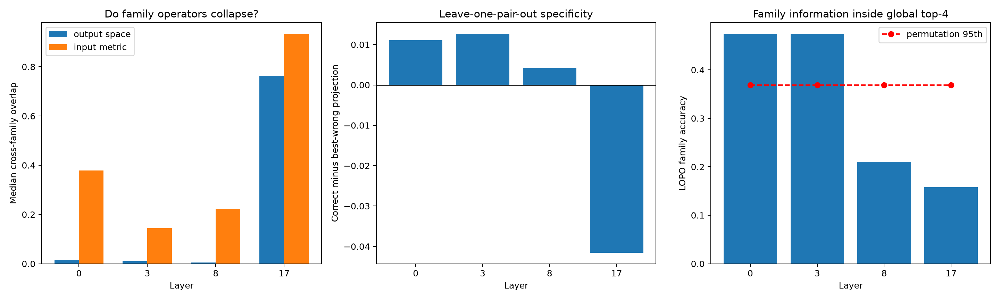

# Red-team of semantic-family collapse at Layer 17

The depth-conditioned result makes five semantic family spaces nearly coincide with the same late global top-four output bottleneck. This follow-up tests whether family distinctions survive in rotation-invariant input operators, leave-one-pair-out write specificity, or coordinate trajectories inside that shared bottleneck. Finite unseen-word interventions ask whether a wrong-family late subspace is causally substitutable.

## Locked hypotheses

- **C1_late_family_output_spaces_collapse: supported.**
- **C2_late_family_input_operators_also_collapse: supported.**
- **C3_leave_one_pair_out_output_specificity_disappears_late: not supported.**
- **C4_shared_late_coordinates_retain_family_information: not supported.**
- **C5_wrong_late_family_spaces_are_causally_substitutable: not supported.**
- **C6_late_shared_patch_is_behaviorally_substantial: not supported.**
- **C7_input_separation_survives_output_collapse: not supported.**
- **C8_late_global_coordinates_are_more_family_specific_than_early: not supported.**

| Layer | Output family overlap | Input family overlap | LOPO projection gap | Coordinate accuracy / null 95th | Permutation p |
|---:|---:|---:|---:|---:|---:|
| 0 | 0.016 | 0.379 | 0.011 | 0.474 / 0.368 | 0.0158 |
| 3 | 0.011 | 0.144 | 0.013 | 0.474 / 0.368 | 0.0097 |
| 8 | 0.005 | 0.223 | 0.004 | 0.211 / 0.368 | 0.5214 |
| 17 | 0.764 | 0.932 | -0.042 | 0.158 / 0.368 | 0.6687 |

| Unseen corpus | Pairs | Best wrong-family fidelity | Correct-family full-MLP fidelity |
|---|---:|---:|---:|
| fineweb | 50 | 0.567 | 0.082 |
| tinystories | 26 | 0.462 | 0.127 |

| Unseen corpus / family | Pairs | Best wrong-family fidelity | Correct-family full-MLP fidelity |
|---|---:|---:|---:|
| fineweb / sentiment | 10 | 0.358 | 0.172 |
| fineweb / gender | 10 | 0.748 | 0.235 |
| fineweb / tense | 10 | 0.755 | 0.098 |
| fineweb / increasing_scale | 10 | 0.092 | -0.045 |
| fineweb / polarity | 10 | 0.701 | -0.226 |
| tinystories / sentiment | 7 | -0.299 | 0.224 |
| tinystories / gender | 5 | 0.778 | 0.245 |
| tinystories / tense | 7 | 0.660 | 0.020 |
| tinystories / increasing_scale | 6 | 0.184 | 0.010 |
| tinystories / polarity | 1 | 0.253 | 0.178 |

Output-subspace identity, input-operator identity, and coordinate multiplexing are distinct possibilities. High family classification inside a shared output space would support multiplexing; low classification plus substitutable wrong-family patches would support a generic bottleneck. Neither outcome says the upstream model lacks semantic distinctions—it localizes where those distinctions cease to correspond to separate native subspaces.
