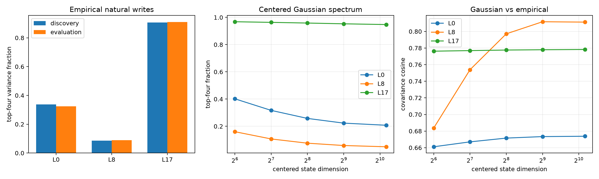

# Centered natural-write spectrum across depth

This replaces uncentered activation weighting with a centered calculation. For `x = mean + Bz`, it includes both the quadratic bilinear term and the mean-state linear cross term, computes the output covariance implied by Gaussian `z`, and compares it with actual centered MLP-write covariance.

## Locked hypotheses

- **C1_late_empirical_concentration: supported.**
- **C2_late_gaussian_concentration: supported.**
- **C3_gaussian_subspace_alignment: not supported.**
- **C4_gaussian_covariance_prediction: not supported.**
- **C5_empirical_subspace_transfer: supported.**
- **C6_mean_cross_term_matters: supported.**

| Layer | Empirical top-4 discovery / eval | Empirical eff. rank discovery / eval | Transfer efficiency | Centered-state eff. rank |
|---:|---:|---:|---:|---:|
| 0 | 0.338 / 0.324 | 20.4 / 21.8 | 0.994 | 123.5 |
| 8 | 0.085 / 0.090 | 237.7 / 226.2 | 0.941 | 227.3 |
| 17 | 0.906 / 0.910 | 3.5 / 3.5 | 0.998 | 16.2 |

| Layer | Dimension | Gaussian top-4 | Gaussian eff. rank | Covariance cosine | Quadratic-only cosine | Top-4 subspace cosine |
|---:|---:|---:|---:|---:|---:|---:|
| 0 | 64 | 0.402 | 12.6 | 0.661 | 0.579 | 0.741 |
| 0 | 128 | 0.317 | 20.6 | 0.667 | 0.589 | 0.732 |
| 0 | 256 | 0.258 | 31.5 | 0.672 | 0.597 | 0.713 |
| 0 | 512 | 0.223 | 42.2 | 0.673 | 0.601 | 0.697 |
| 0 | 1152 | 0.208 | 48.8 | 0.674 | 0.602 | 0.689 |
| 8 | 64 | 0.160 | 82.1 | 0.684 | 0.659 | 0.615 |
| 8 | 128 | 0.107 | 167.6 | 0.754 | 0.741 | 0.610 |
| 8 | 256 | 0.076 | 282.4 | 0.797 | 0.795 | 0.606 |
| 8 | 512 | 0.059 | 388.9 | 0.812 | 0.813 | 0.599 |
| 8 | 1152 | 0.050 | 465.2 | 0.811 | 0.813 | 0.594 |
| 17 | 64 | 0.968 | 2.3 | 0.776 | 0.496 | 0.955 |
| 17 | 128 | 0.964 | 2.4 | 0.777 | 0.505 | 0.955 |
| 17 | 256 | 0.958 | 2.4 | 0.778 | 0.511 | 0.954 |
| 17 | 512 | 0.953 | 2.4 | 0.778 | 0.515 | 0.954 |
| 17 | 1152 | 0.947 | 2.5 | 0.778 | 0.518 | 0.954 |

The Gaussian calculation is a moment-matched model, not a claim that residual states are Gaussian. Its failures localize non-Gaussian or higher-order state structure that a cleaned weight spectrum omits; empirical write PCA is the authoritative natural-distribution comparison.
