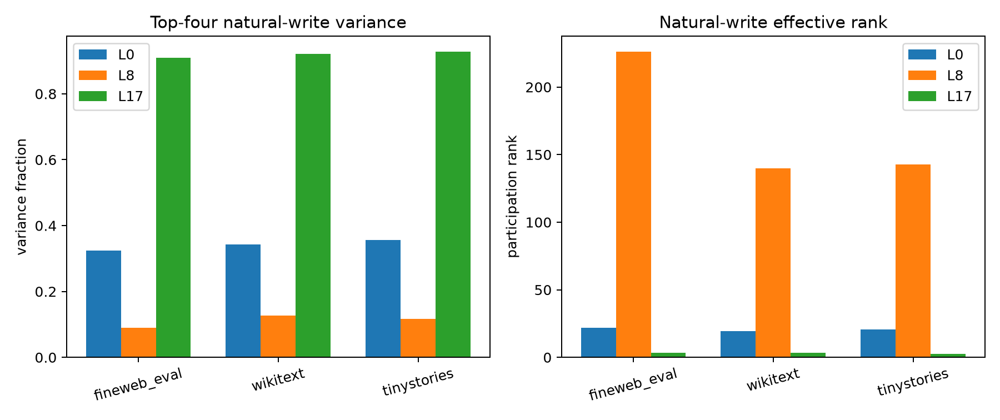

# OOD replication of depth-dependent natural-write spectra

Centered MLP-write covariance is measured independently on held-out FineWeb, WikiText-103, and TinyStories. The top-four output subspace is fit only on the FineWeb discovery panel, then frozen for transfer tests.

## Locked hypotheses

- **O1_late_concentration_transfers: supported.**
- **O2_middle_distribution_transfers: supported.**
- **O3_early_intermediate_transfers: supported.**
- **O4_regime_order_is_stable: supported.**
- **O5_fineweb_subspace_transfers: not supported.**

| Layer | Corpus | Top-four variance | Effective rank | FineWeb-subspace efficiency | Mean canonical cosine |
|---:|---|---:|---:|---:|---:|
| 0 | fineweb_eval | 0.324 | 21.8 | 0.994 | 0.992 |
| 0 | wikitext | 0.343 | 19.2 | 0.896 | 0.886 |
| 0 | tinystories | 0.356 | 20.8 | 0.902 | 0.855 |
| 8 | fineweb_eval | 0.090 | 226.2 | 0.941 | 0.951 |
| 8 | wikitext | 0.126 | 140.1 | 0.715 | 0.765 |
| 8 | tinystories | 0.117 | 142.7 | 0.624 | 0.591 |
| 17 | fineweb_eval | 0.910 | 3.5 | 0.998 | 0.997 |
| 17 | wikitext | 0.921 | 3.2 | 0.991 | 0.990 |
| 17 | tinystories | 0.928 | 2.7 | 0.983 | 0.970 |

These are output-variance regimes, not claims about semantic monosemanticity. A low-rank late write can combine multiple contexts, and a high-rank middle write can still contain individually clean conditional operations.
