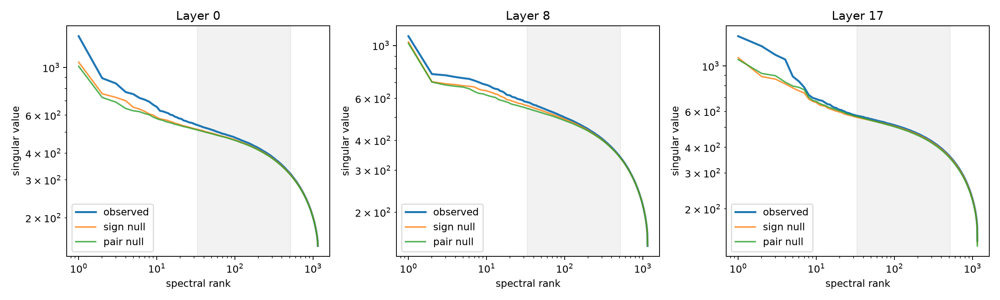

# Full-width power-law spectra and coordination nulls across depth

Each complete bilinear MLP tensor is treated as a map from symmetric input interactions to residual writes. Its output-side singular spectrum is computed exactly through the channel Gram matrix. Sign nulls preserve each channel form and Down column magnitude while changing cross-channel coordination; pairing nulls reassign Down columns to input channel forms.

## Locked hypotheses

- **T1_powerlaw_bulk_all_layers: supported.**
- **T2_nulls_retain_bulk: supported.**
- **T3_observed_exceeds_null_median: not supported.**
- **T4_strict_positive_outliers: not supported.**
- **T5_late_full_width_concentration: supported.**
- **T6_late_exceeds_all_nulls: supported.**

| Layer | Observed alpha / R² | Top-1 log excess | Mean top-4 excess | Top-4 energy | Sign-null excess | Pair-null excess |
|---:|---:|---:|---:|---:|---:|---:|
| 0 | 0.200 / 0.957 | 0.171 | -0.058 | 0.031 | -0.158 | -0.206 |
| 8 | 0.201 / 0.966 | -0.140 | -0.264 | 0.020 | -0.282 | -0.248 |
| 17 | 0.178 / 0.945 | 0.187 | 0.182 | 0.037 | -0.074 | -0.070 |

A positive log excess is the strict above-extrapolated-power-law criterion. Exceeding a coordination null instead shows learned cross-channel structure relative to that null; neither criterion by itself establishes semantics or causal sufficiency.
