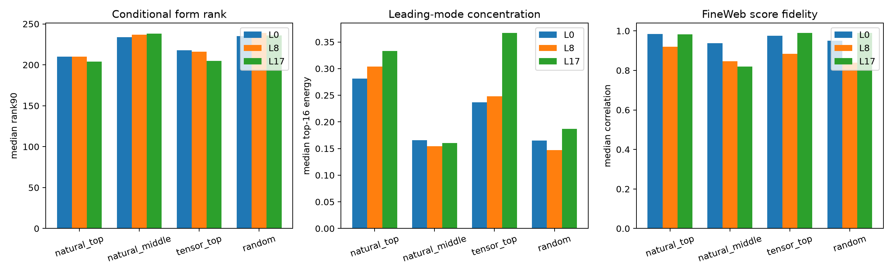

# Query-wise compactness across depth

This asks whether a globally broad layer is nevertheless a library of individually compact operations. Output queries are frozen from FineWeb discovery writes (`natural_top`, `natural_middle`), the complete raw tensor (`tensor_top`), or a random orthonormal control. Each query is converted exactly into an interaction form inside state-SVD input bases and evaluated on three corpora.

## Locked hypotheses

- **Q1_middle_queries_are_individually_compact: not supported.**
- **Q2_natural_queries_beat_random_compactness: supported.**
- **Q3_natural_query_scores_are_faithful: supported.**
- **Q4_tensor_top_queries_are_naturally_used: supported.**
- **Q5_middle_queries_are_relatively_distributed: not supported.**
- **Q6_query_interpreter_transfers_ood: supported.**

### Dimension 512

| Layer | Query family | Top-4 energy | Top-16 energy | Rank90 | Eff. rank | Fine/Wiki/Tiny corr. | FineWeb variance |
|---:|---|---:|---:|---:|---:|---:|---:|
| 0 | natural_top | 0.144 | 0.281 | 210 | 68.7 | 0.984/0.980/0.986 | 1.46e+07 |
| 0 | natural_middle | 0.054 | 0.166 | 234 | 197.2 | 0.937/0.926/0.944 | 1.27e+06 |
| 0 | tensor_top | 0.109 | 0.237 | 218 | 108.9 | 0.976/0.969/0.976 | 1.31e+07 |
| 0 | random | 0.057 | 0.165 | 235 | 195.1 | 0.949/0.941/0.958 | 9.40e+05 |
| 8 | natural_top | 0.159 | 0.304 | 210 | 79.6 | 0.919/0.922/0.922 | 2.44e+04 |
| 8 | natural_middle | 0.048 | 0.154 | 237 | 207.7 | 0.847/0.842/0.855 | 5.95e+03 |
| 8 | tensor_top | 0.107 | 0.248 | 216 | 116.8 | 0.884/0.873/0.884 | 2.53e+04 |
| 8 | random | 0.044 | 0.147 | 239 | 213.6 | 0.838/0.835/0.844 | 3.51e+03 |
| 17 | natural_top | 0.189 | 0.333 | 204 | 41.5 | 0.983/0.979/0.979 | 5.90e+06 |
| 17 | natural_middle | 0.052 | 0.161 | 238 | 201.2 | 0.819/0.810/0.841 | 9.63e+04 |
| 17 | tensor_top | 0.223 | 0.367 | 205 | 43.5 | 0.990/0.990/0.989 | 9.71e+06 |
| 17 | random | 0.077 | 0.187 | 236 | 174.2 | 0.989/0.990/0.988 | 1.40e+06 |

Query-wise low rank is conditional simplicity, not a neuron count. Different queries may reuse overlapping modes, and the 512D basis still omits part of layers 0 and 8. Random and middle-spectrum queries expose how much apparent compactness follows generically from restricting the input manifold.
