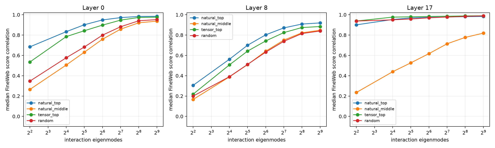

# Natural-score truncation of queried forms across depth

Weight-energy rank90 was about 200 modes even for leading natural queries. This red-team asks how many signed eigenmodes are needed to predict the query's actual score on held-out language states. Queries and the 512D FineWeb state basis are frozen before evaluation on three corpora.

## Locked hypotheses

- **B1_rank64_natural_direction_fidelity: not supported.**
- **B2_rank64_natural_magnitude_fidelity: not supported.**
- **B3_late_needs_fewer_behavioral_modes: supported.**
- **B4_natural_head_beats_random: not supported.**
- **B5_late_tensor_spikes_have_compact_scores: supported.**

| Layer | Query family | Corpus | First rank corr≥.90 & R²≥.80 | Rank-16 corr/R² | Rank-64 corr/R² | Rank-512 corr/R² |
|---:|---|---|---:|---:|---:|---:|
| 0 | natural_top | fineweb | 64 | 0.833/0.584 | 0.949/0.823 | 0.984/0.960 |
| 0 | natural_top | wikitext | 64 | 0.862/0.637 | 0.948/0.839 | 0.980/0.950 |
| 0 | natural_top | tinystories | 64 | 0.838/0.552 | 0.946/0.824 | 0.986/0.966 |
| 0 | natural_middle | fineweb | 256 | 0.505/0.235 | 0.759/0.548 | 0.937/0.870 |
| 0 | natural_middle | wikitext | 256 | 0.514/0.240 | 0.752/0.542 | 0.926/0.848 |
| 0 | natural_middle | tinystories | 256 | 0.504/0.227 | 0.744/0.523 | 0.944/0.885 |
| 0 | tensor_top | fineweb | 128 | 0.784/0.498 | 0.898/0.748 | 0.976/0.944 |
| 0 | tensor_top | wikitext | 128 | 0.799/0.496 | 0.901/0.750 | 0.969/0.931 |
| 0 | tensor_top | tinystories | 128 | 0.799/0.489 | 0.905/0.757 | 0.976/0.948 |
| 0 | random | fineweb | 256 | 0.576/0.264 | 0.799/0.574 | 0.952/0.903 |
| 0 | random | wikitext | 256 | 0.586/0.281 | 0.791/0.581 | 0.945/0.884 |
| 0 | random | tinystories | 256 | 0.577/0.258 | 0.807/0.593 | 0.957/0.913 |
| 8 | natural_top | fineweb | 512 | 0.562/0.298 | 0.802/0.598 | 0.919/0.824 |
| 8 | natural_top | wikitext | 256 | 0.536/0.266 | 0.795/0.578 | 0.922/0.837 |
| 8 | natural_top | tinystories | 256 | 0.564/0.286 | 0.782/0.560 | 0.922/0.832 |
| 8 | natural_middle | fineweb | — | 0.389/0.143 | 0.641/0.388 | 0.847/0.707 |
| 8 | natural_middle | wikitext | — | 0.385/0.140 | 0.636/0.375 | 0.842/0.700 |
| 8 | natural_middle | tinystories | — | 0.396/0.147 | 0.650/0.393 | 0.855/0.722 |
| 8 | tensor_top | fineweb | — | 0.507/0.251 | 0.742/0.528 | 0.884/0.766 |
| 8 | tensor_top | wikitext | — | 0.482/0.230 | 0.709/0.481 | 0.873/0.749 |
| 8 | tensor_top | tinystories | — | 0.476/0.224 | 0.717/0.490 | 0.884/0.771 |
| 8 | random | fineweb | — | 0.390/0.146 | 0.632/0.383 | 0.840/0.700 |
| 8 | random | wikitext | — | 0.392/0.146 | 0.607/0.351 | 0.825/0.676 |
| 8 | random | tinystories | — | 0.372/0.134 | 0.611/0.355 | 0.842/0.699 |
| 17 | natural_top | fineweb | 16 | 0.953/0.907 | 0.974/0.944 | 0.983/0.964 |
| 17 | natural_top | wikitext | 4 | 0.955/0.910 | 0.971/0.939 | 0.979/0.955 |
| 17 | natural_top | tinystories | 16 | 0.952/0.898 | 0.965/0.924 | 0.979/0.956 |
| 17 | natural_middle | fineweb | — | 0.439/0.192 | 0.617/0.381 | 0.819/0.668 |
| 17 | natural_middle | wikitext | — | 0.414/0.163 | 0.587/0.343 | 0.810/0.652 |
| 17 | natural_middle | tinystories | — | 0.465/0.211 | 0.640/0.409 | 0.841/0.706 |
| 17 | tensor_top | fineweb | 4 | 0.976/0.928 | 0.983/0.954 | 0.990/0.978 |
| 17 | tensor_top | wikitext | 4 | 0.976/0.922 | 0.983/0.951 | 0.990/0.977 |
| 17 | tensor_top | tinystories | 4 | 0.973/0.924 | 0.982/0.950 | 0.989/0.976 |
| 17 | random | fineweb | 4 | 0.950/0.865 | 0.969/0.929 | 0.989/0.977 |
| 17 | random | wikitext | 4 | 0.951/0.861 | 0.971/0.923 | 0.991/0.981 |
| 17 | random | tinystories | 4 | 0.957/0.879 | 0.975/0.935 | 0.992/0.984 |

This is observational score sufficiency inside a fixed 512D state basis. It does not establish that the same truncated modes predict finite edits, because tangent effects include context cross terms and can require a larger causal quotient.
