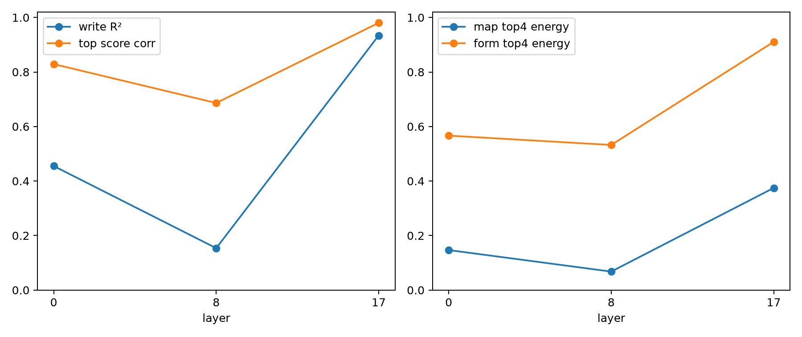

# Standardized depth replication of query-map structure

Layers 0, 8, and 17 are analyzed with the same state-SVD-64 input basis, output×64×64 query map, leading-component score test, four-mode input-form audit, and state-SVD-128 tangent context. This avoids changing the explanatory object between depths.

## Locked hypotheses

- **M1_state64_write_fidelity: not supported.**
- **M2_top_component_score_fidelity: not supported.**
- **M3_low_rank_component_forms: not supported.**
- **M4_context128_tangent_fidelity: not supported.**
- **M5_late_spectral_concentration: supported.**

| Layer | Write R² | Top-four map energy | Top-four score corr. | Four-mode form energy | Tangent 64 / 128 |
|---:|---:|---:|---:|---:|---:|
| 0 | 0.455 | 0.147 | 0.829 | 0.567 | 0.792 / 0.818 |
| 8 | 0.154 | 0.068 | 0.686 | 0.532 | 0.940 / 0.951 |
| 17 | 0.934 | 0.375 | 0.980 | 0.911 | 0.969 / 0.979 |

This is a layer-local replication. It does not test how middle-layer writes propagate to final logits or whether output singular vectors have the same human semantics across depth.
