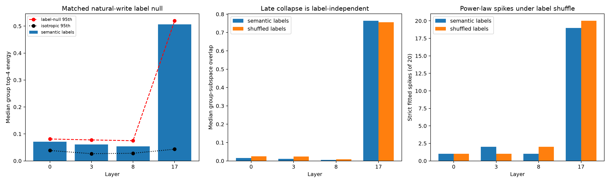

# Natural-write semantic-label nulls across depth

Isotropic random output spaces do not match the data-dependent selection of semantic family spaces. This red-team preserves the exact 19 natural counterfactual write trajectories and group sizes, randomly reassigning lexical pairs to five pseudo-families before repeating output-basis fitting, tensor canonicalization, and input-spectrum measurement.

## Locked hypotheses

- **L1_early_semantic_grouping_enriches_conditioned_concentration: not supported.**
- **L2_late_conditioned_concentration_is_not_semantic_specific: supported.**
- **L3_late_family_collapse_occurs_under_label_shuffle: supported.**
- **L4_late_strict_spikes_occur_under_label_shuffle: supported.**
- **L5_semantic_labels_matter_more_early_than_late: supported.**
- **L6_isotropic_random_control_was_overoptimistic_late: supported.**

| Layer | Observed / label-null 95th top-4 | Empirical p / z | Observed / shuffled overlap | Strict observed / shuffled median | Isotropic 95th |
|---:|---:|---:|---:|---:|---:|
| 0 | 0.071 / 0.081 | 0.492 / -0.06 | 0.016 / 0.025 | 1 / 1.0 | 0.039 |
| 3 | 0.061 / 0.078 | 0.554 / -0.17 | 0.011 / 0.024 | 2 / 1.0 | 0.027 |
| 8 | 0.054 / 0.075 | 0.738 / -0.65 | 0.005 / 0.009 | 1 / 2.0 | 0.028 |
| 17 | 0.507 / 0.520 | 0.831 / -1.09 | 0.764 / 0.757 | 19 / 20.0 | 0.043 |

The label-shuffle null asks whether semantic grouping matters after conditioning on natural write selection. Passing only the isotropic control establishes that natural writes occupy an exceptional tensor region; exceeding the label null is required to attribute additional spectral concentration to the semantic partition itself.
