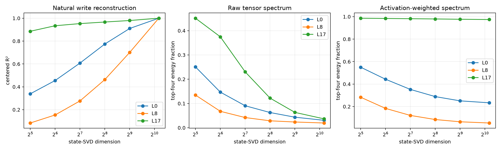

# Depth spectral basis-and-scale red-team

This reruns the layer comparison across state-subspace dimensions and computes the output-side tensor spectrum through an exact channel Gram matrix. `raw` uses orthonormal state-SVD directions; `weighted` scales each direction by its natural RMS coordinate, so its spectrum prioritizes operations encountered on the discovery distribution.

## Locked hypotheses

- **R1_late_raw_concentration: supported.**
- **R2_late_natural_concentration: supported.**
- **R3_middle_requires_more_state_dimensions: supported.**
- **R4_fixed64_understates_early_fidelity: supported.**
- **R5_raw_and_natural_rankings_agree: supported.**
- **R6_top_weight_component_is_naturally_relevant: supported.**

| Layer | Dimension | Write R² | Raw top-4 | Weighted top-4 | Raw eff. rank | Weighted eff. rank |
|---:|---:|---:|---:|---:|---:|---:|
| 0 | 32 | 0.339 | 0.251 | 0.550 | 31.6 | 6.2 |
| 0 | 64 | 0.455 | 0.147 | 0.443 | 87.1 | 9.8 |
| 0 | 128 | 0.608 | 0.091 | 0.352 | 205.0 | 15.7 |
| 0 | 256 | 0.774 | 0.063 | 0.289 | 360.1 | 23.8 |
| 0 | 512 | 0.910 | 0.043 | 0.251 | 532.5 | 31.8 |
| 0 | 1152 | 1.000 | 0.031 | 0.233 | 670.2 | 36.7 |
| 8 | 32 | 0.084 | 0.135 | 0.283 | 106.9 | 31.0 |
| 8 | 64 | 0.154 | 0.068 | 0.184 | 281.7 | 70.3 |
| 8 | 128 | 0.277 | 0.042 | 0.121 | 479.7 | 146.3 |
| 8 | 256 | 0.463 | 0.029 | 0.084 | 622.8 | 254.3 |
| 8 | 512 | 0.701 | 0.024 | 0.064 | 701.4 | 359.9 |
| 8 | 1152 | 1.000 | 0.020 | 0.054 | 761.3 | 438.1 |
| 17 | 32 | 0.886 | 0.451 | 0.986 | 16.8 | 1.6 |
| 17 | 64 | 0.934 | 0.375 | 0.984 | 23.2 | 1.6 |
| 17 | 128 | 0.953 | 0.230 | 0.982 | 59.6 | 1.7 |
| 17 | 256 | 0.967 | 0.122 | 0.979 | 185.5 | 1.7 |
| 17 | 512 | 0.980 | 0.063 | 0.977 | 450.2 | 1.7 |
| 17 | 1152 | 1.000 | 0.037 | 0.974 | 670.4 | 1.7 |

Full-width raw-versus-weighted output-component overlap:

| Layer | Best cosine for leading raw component | Weighted rank | State effective rank |
|---:|---:|---:|---:|
| 0 | 0.703 | 2 | 88.0 |
| 8 | 0.759 | 1 | 1.2 |
| 17 | 0.961 | 4 | 3.2 |

The weighted spectrum is not a distribution-free RMT object: it combines weights with the FineWeb state distribution. The raw spectrum is weight-local but still conditioned on the chosen input subspace. Agreement between them identifies high-weight operations that are also naturally exercised.
