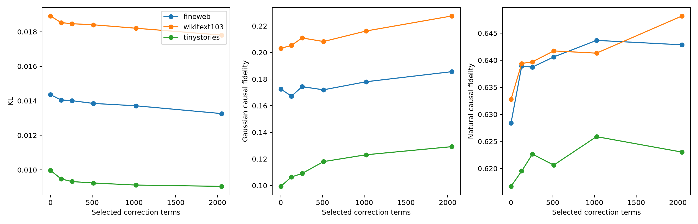

# Downstream-ranked CP correction curve

## Hypotheses

- **H1_sparse_behavior: not supported.**
- **H2_sparse_causal: not supported.**
- **H3_transfer: supported.**
- **H4_ranking_control: supported.**

| Terms | Rank upper bound | FineWeb KL | FW Gaussian | FW natural |
|---:|---:|---:|---:|---:|
| 0 | 2048 | 0.0144 | 0.173 | 0.628 |
| 128 | 2176 | 0.0140 | 0.167 | 0.639 |
| 256 | 2304 | 0.0140 | 0.174 | 0.639 |
| 512 | 2560 | 0.0138 | 0.172 | 0.641 |
| 1024 | 3072 | 0.0137 | 0.178 | 0.644 |
| 2048 | 4096 | 0.0133 | 0.186 | 0.643 |

The ranking is the negative first-order gradient at the language model, averaged after separately normalizing base-KL, intervened-KL, and Fisher-effect gradients. Selection rows are disjoint from all evaluation rows.

This is still an inherited-factor-basis test. A failure means no small subset was found by this local ranking; it is not a proof that no sparse basis exists.

Raw results: `downstream_rank_selection_results.json`.
