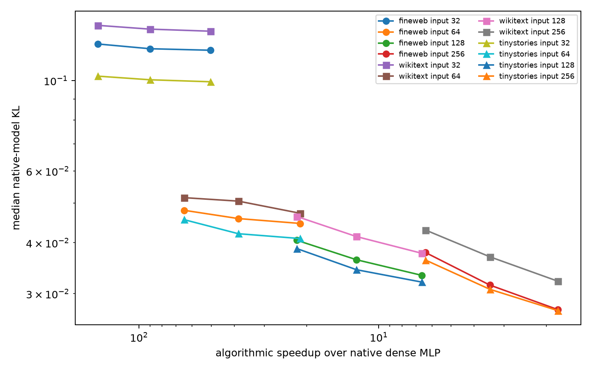

# Efficient final-MLP compute–fidelity frontier

Hybrid input dimensions 32/64/128/256 are crossed with natural-write output ranks 32/64/128. Every cell is an executable quadratic program without native-channel scoring; multiply counts include input projection, monomials, quadratic scoring, and output decoding.

## Locked hypotheses

- **P1_128x64_useful_frontier: not supported.**
- **P2_128x128_higher_fidelity: not supported.**
- **P3_256x64_strong_fidelity: not supported.**
- **P4_monotone_input_width: supported.**
- **P5_monotone_output_rank: supported.**

| Input×output | Speedup | FineWeb KL | WikiText KL | TinyStories KL |
|---:|---:|---:|---:|---:|
| 32×32 | 148.1× | 0.1230 | 0.1366 | 0.1026 |
| 32×64 | 89.9× | 0.1197 | 0.1338 | 0.1005 |
| 32×128 | 50.3× | 0.1187 | 0.1322 | 0.0994 |
| 64×32 | 64.8× | 0.0481 | 0.0516 | 0.0456 |
| 64×64 | 38.5× | 0.0459 | 0.0506 | 0.0421 |
| 64×128 | 21.2× | 0.0446 | 0.0472 | 0.0410 |
| 128×32 | 22.0× | 0.0406 | 0.0464 | 0.0387 |
| 128×64 | 12.4× | 0.0363 | 0.0414 | 0.0343 |
| 128×128 | 6.6× | 0.0333 | 0.0377 | 0.0320 |
| 256×32 | 6.4× | 0.0379 | 0.0430 | 0.0363 |
| 256×64 | 3.4× | 0.0315 | 0.0370 | 0.0308 |
| 256×128 | 1.8× | 0.0274 | 0.0322 | 0.0273 |

These are algorithmic dense-multiply counts, not wall-clock benchmarks. The unembedding dominates neither count here nor the comparison because it is unchanged across models.
