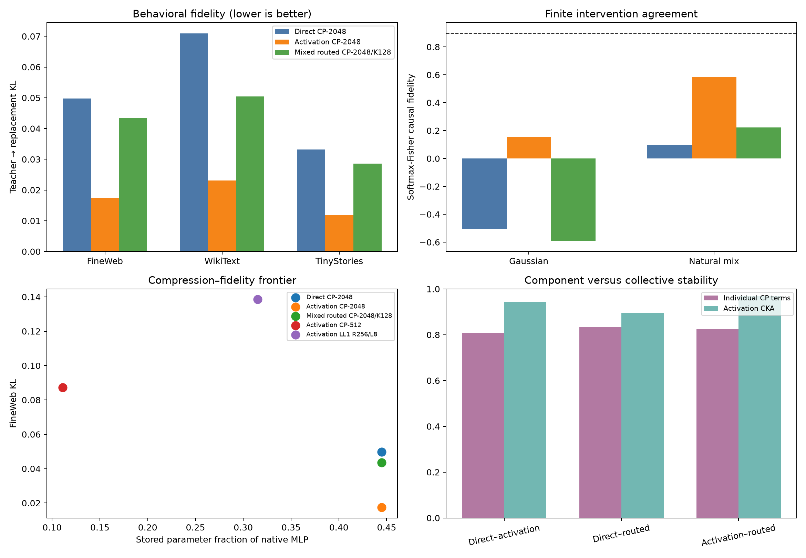

# Bilin18 decomposition evaluation scorecard

## Outcome

- **H1_manifold_gap: supported.**
- **H2_causal_gap: not supported.**
- **H3_sparse_conditional_program: supported.**
- **H4_collective_over_component_stability: supported.**
- **H5_semantic_transfer: supported.**
- **H6_no_current_full_pass: supported.**

## Primary behavioral results

| Model | FineWeb KL | WikiText KL | TinyStories KL | FineWeb top-1 |
|---|---:|---:|---:|---:|
| Direct CP-2048 | 0.0498 | 0.0709 | 0.0332 | 0.869 |
| Activation CP-2048 | 0.0174 | 0.0231 | 0.0118 | 0.923 |
| Mixed routed CP-2048/K128 | 0.0435 | 0.0504 | 0.0286 | 0.888 |

## Causal results

| Model | Gaussian fidelity | Gaussian cosine | Natural-mix fidelity | Natural-mix cosine |
|---|---:|---:|---:|---:|
| Direct CP-2048 | -0.503 | 0.472 | 0.096 | 0.589 |
| Activation CP-2048 | 0.157 | 0.557 | 0.584 | 0.807 |
| Mixed routed CP-2048/K128 | -0.592 | 0.298 | 0.223 | 0.672 |

## Gate verdicts

- **Direct CP-2048:** 2/11 gates; does not fully pass.
- **Activation CP-2048:** 4/11 gates; does not fully pass.
- **Mixed routed CP-2048/K128:** 3/12 gates; does not fully pass.

## What changed

- **The global-tensor causal hypothesis was falsified here.** Activation CP-2048 is more behaviorally and causally faithful than direct CP-2048 on every tested primary condition, despite retaining less isotropic tensor energy.
- **None of the candidates is a faithful causal replacement.** Activation CP-2048 is the best current candidate, but remains far below the 0.90 intervention gate.
- **The routed code is genuinely local but not globally small.** It activates 128/2048 factors per token, uses 2048/2048 over the corpus, and has entropy-effective support 1838.
- **The current router is not an ideal sparse implementation.** It uses approximately 30.6% of native multiplies because all factor scores are computed; an indexed router would use approximately 2.8% before routing overhead.
- **Restricted semantics transfer.** Activation CP's mean oriented AUROC is 0.900 on WikiText and 0.907 on TinyStories.
- **Collective structure is more stable than individual terms within this checkpoint lineage.** This is not an independent-identifiability result because all three CP models descend from the same initialization.

The post-confirmatory scale and OOD red-team is in `CAUSAL_METRIC_REDTEAM.md`.

## Interpretation limits

- Causal interventions modify only the layer-1 MLP input; they do not establish fidelity for arbitrary edits elsewhere in the network.
- The primary causal score uses the teacher baseline softmax as a Fisher weighting. Uniform-vocabulary effect scores remain in the JSON as a stricter secondary diagnostic.
- Factor comparisons are across objectives descended from a shared initialization, not independent global CP discoveries.
- Token-form categories are a deliberately small semantic vocabulary. Failure means unexplained by this audit, not meaningless.
- Sequence-bootstrap intervals describe corpus sampling uncertainty, not uncertainty across independently trained base models.

Raw results: `evaluation_scorecard.json`.
