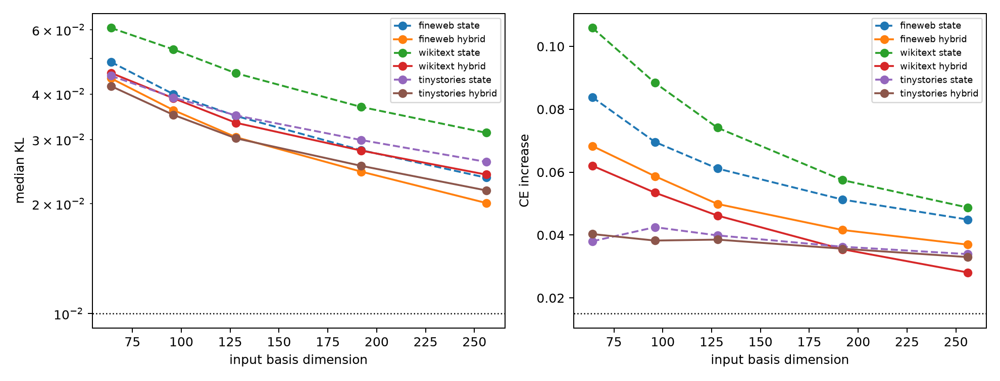

# Behavioral dimension sweep for the final-MLP input quotient

State-only and semantic+state hybrid bases are compared at matched dimensions on data disjoint from the 64D selection panel. Every replacement is propagated through final RMSNorm and the complete unembedding.

## Locked hypotheses

- **D1_hybrid128_intermediate_fidelity: not supported.**
- **D2_hybrid256_high_fidelity: not supported.**
- **D3_hybrid_matched_width_advantage: supported.**
- **D4_ood_threshold_by_256: not supported.**
- **D5_hybrid256_top1: not supported.**

| Corpus | Basis | 64 | 96 | 128 | 192 | 256 |
|---|---|---:|---:|---:|---:|---:|
| fineweb | state KL | 0.0490 | 0.0400 | 0.0348 | 0.0281 | 0.0236 |
| fineweb | hybrid KL | 0.0442 | 0.0361 | 0.0305 | 0.0245 | 0.0201 |
| wikitext | state KL | 0.0607 | 0.0530 | 0.0456 | 0.0369 | 0.0313 |
| wikitext | hybrid KL | 0.0457 | 0.0389 | 0.0334 | 0.0280 | 0.0241 |
| tinystories | state KL | 0.0449 | 0.0391 | 0.0349 | 0.0299 | 0.0261 |
| tinystories | hybrid KL | 0.0421 | 0.0351 | 0.0302 | 0.0254 | 0.0218 |

Dimension is input-state dimension, not operation count. These quotients still call the full native bilinear channel bank; an efficient tensor contraction is a separate requirement.
