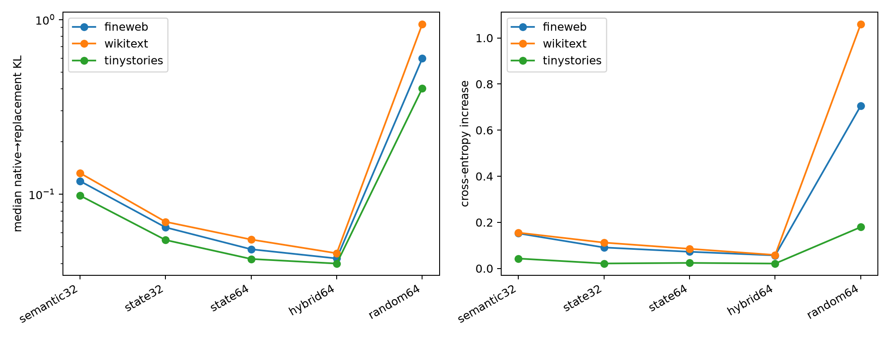

# End-to-end final-MLP input-basis replacement

Each basis projects the actual layer-17 MLP input before recomputing all 4,608 bilinear products. The resulting write is inserted into the native final residual path, including final RMSNorm and unembedding. Metrics cover disjoint FineWeb plus OOD WikiText and TinyStories positions.

## Locked hypotheses

- **F1_hybrid_behavioral_fidelity: not supported.**
- **F2_hybrid_ce_fidelity: not supported.**
- **F3_state64_behavioral_fidelity: not supported.**
- **F4_hybrid_improves_specialists: supported.**
- **F5_random_control_fails: supported.**

| Corpus | Basis | Median KL | CE increase | Top-1 agreement | Write cosine | Relative write error |
|---|---|---:|---:|---:|---:|---:|
| fineweb | semantic32 | 0.1189 | 0.1521 | 79.6% | 0.860 | 0.580 |
| fineweb | state32 | 0.0645 | 0.0909 | 84.5% | 0.986 | 0.195 |
| fineweb | state64 | 0.0483 | 0.0723 | 84.7% | 0.990 | 0.160 |
| fineweb | hybrid64 | 0.0428 | 0.0565 | 84.8% | 0.991 | 0.138 |
| fineweb | random64 | 0.5979 | 0.7056 | 77.9% | 0.023 | 1.000 |
| wikitext | semantic32 | 0.1321 | 0.1551 | 77.4% | 0.864 | 0.557 |
| wikitext | state32 | 0.0695 | 0.1121 | 82.2% | 0.986 | 0.197 |
| wikitext | state64 | 0.0550 | 0.0851 | 84.0% | 0.989 | 0.170 |
| wikitext | hybrid64 | 0.0459 | 0.0584 | 83.1% | 0.991 | 0.139 |
| wikitext | random64 | 0.9416 | 1.0601 | 72.3% | 0.066 | 0.999 |
| tinystories | semantic32 | 0.0982 | 0.0429 | 80.8% | 0.835 | 0.603 |
| tinystories | state32 | 0.0546 | 0.0215 | 84.7% | 0.986 | 0.189 |
| tinystories | state64 | 0.0425 | 0.0240 | 84.8% | 0.989 | 0.162 |
| tinystories | hybrid64 | 0.0400 | 0.0211 | 85.0% | 0.991 | 0.140 |
| tinystories | random64 | 0.4032 | 0.1793 | 81.1% | -0.028 | 1.001 |

This validates an input quotient, not yet an efficient replacement: the current implementation still evaluates all 4,608 native products after projection. An efficient model must contract or factor the resulting output×basis×basis tensor and count those operations.
