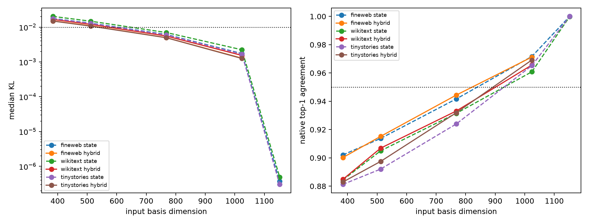

# Large-dimension final-MLP quotient sweep

The state and hybrid basis sweeps continue through the full 1,152D residual width on a second disjoint evaluation panel. This locates the behavioral tail missed by high local write R².

## Locked hypotheses

- **L1_hybrid512_high_fidelity: not supported.**
- **L2_hybrid768_near_exact: not supported.**
- **L3_threshold_by_768: supported.**
- **L4_hybrid_advantage_persists: supported.**
- **L5_full_basis_control: supported.**

| Corpus | Basis | 384 | 512 | 768 | 1,024 | 1,152 |
|---|---|---:|---:|---:|---:|---:|
| fineweb | state KL | 0.01778 | 0.01304 | 0.00616 | 0.00174 | 0.00000 |
| fineweb | hybrid KL | 0.01508 | 0.01089 | 0.00498 | 0.00128 | — |
| wikitext | state KL | 0.02033 | 0.01479 | 0.00699 | 0.00224 | 0.00000 |
| wikitext | hybrid KL | 0.01667 | 0.01201 | 0.00555 | 0.00154 | — |
| tinystories | state KL | 0.01758 | 0.01280 | 0.00599 | 0.00168 | 0.00000 |
| tinystories | hybrid KL | 0.01494 | 0.01069 | 0.00496 | 0.00126 | — |

The full state basis is an algebraic control. Any residual discrepancy there is floating-point error rather than representational compression.
