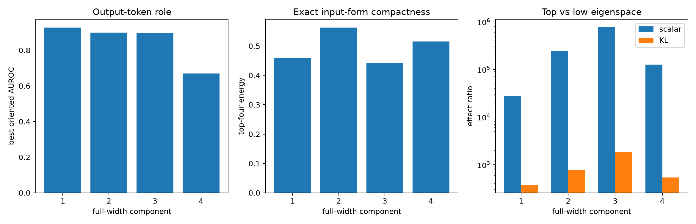

# Semantic and causal validation of full-width layer-17 tensor outliers

These are the four strict full-width weight-spectrum spikes, selected before looking at their token roles or finite interventions. They are compared with the previous state-64 query map and empirical natural-write PCA, then tested through their exact 1,152-dimensional input interaction forms.

## Locked hypotheses

- **F1_same_as_state_query_components: supported.**
- **F2_same_as_natural_write_subspace: supported.**
- **F3_simple_output_roles: not supported.**
- **F4_low_rank_input_forms: not supported.**
- **F5_top_modes_are_specific: supported.**
- **F6_top_modes_reach_behavior: supported.**
- **F7_weight_formula_predicts_edits: supported.**

Mean canonical cosine with state-64 query components: **0.979**; with natural-write PCs: **0.930**.

| Component | Output role | AUROC | Form top-4 | Natural variance | Top/low scalar | Top/low KL | Prediction corr. |
|---:|---|---:|---:|---:|---:|---:|---:|
| 1 | comma_period | 0.927 | 0.460 | 3.53e+08 | 27750.0× | 376.7× | 1.000 |
| 2 | comma_period | 0.899 | 0.563 | 5.84e+08 | 249276.2× | 769.0× | 1.000 |
| 3 | comma_period | 0.895 | 0.443 | 3.24e+08 | 767593.8× | 1862.7× | 1.000 |
| 4 | comma_period | 0.669 | 0.516 | 3.97e+08 | 126217.5× | 541.3× | 1.000 |

A simple output predicate describes what an outlier tends to promote or suppress; it does not by itself describe all upstream conditions that activate it. Exact-form intervention prediction establishes the local bilinear operation, while final-logit KL establishes downstream participation rather than task-level sufficiency.
