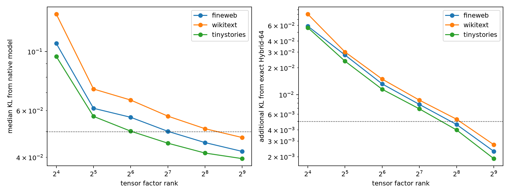

# Efficient factorization of the Hybrid-64 final MLP

The native 4,608-channel final MLP is first contracted exactly into an output×64×64 tensor, then SVD-factorized into shared scalar quadratic features and output directions. Evaluation uses the factored program directly; native channels are not scored.

## Locked hypotheses

- **E1_exact_contraction: supported.**
- **E2_rank128_preserves_hybrid: not supported.**
- **E3_rank128_native_fidelity: not supported.**
- **E4_rank128_compute_reduction: supported.**
- **E5_rank64_useful: not supported.**

| Rank | Tensor energy | Counted multiplications | Dense speedup | FineWeb native KL | WikiText native KL | TinyStories native KL |
|---:|---:|---:|---:|---:|---:|---:|
| 16 | 70.3% | 161,792 | 98.4× | 0.1072 | 0.1382 | 0.0958 |
| 32 | 77.3% | 245,760 | 64.8× | 0.0612 | 0.0723 | 0.0570 |
| 64 | 82.0% | 413,696 | 38.5× | 0.0566 | 0.0657 | 0.0502 |
| 128 | 86.6% | 749,568 | 21.2× | 0.0501 | 0.0571 | 0.0452 |
| 256 | 91.8% | 1,421,312 | 11.2× | 0.0454 | 0.0512 | 0.0415 |
| 512 | 97.0% | 2,764,800 | 5.8× | 0.0421 | 0.0475 | 0.0395 |

Multiply counts include input projection, explicit quadratic monomials, quadratic-feature scoring, and output decoding. They omit RMSNorm, unembedding, memory traffic, and kernel-launch overhead, so they are algorithmic—not measured wall-clock—speedups.
