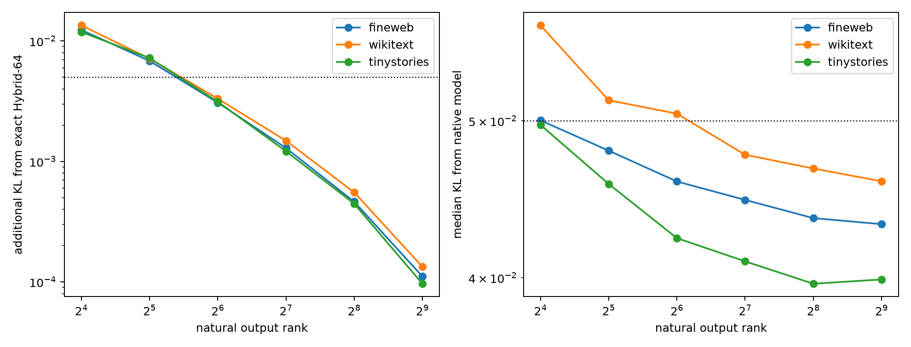

# Natural-write factorization of the Hybrid-64 final MLP

The exact contracted Hybrid-64 tensor is factorized using PCA of its writes on a separate FineWeb discovery panel. Each output PC has an exactly derived 64×64 quadratic scoring matrix, so execution cost matches the global tensor-SVD factorization at the same rank.

## Locked hypotheses

- **A1_natural_rank128_improves: supported.**
- **A2_natural_rank128_preserves_hybrid: supported.**
- **A3_natural_rank64_useful: supported.**
- **A4_ood_transfer: supported.**
- **A5_rank128_native_fidelity: supported.**

| Rank | Discovery write variance | FineWeb add. KL | WikiText add. KL | TinyStories add. KL | FineWeb native KL |
|---:|---:|---:|---:|---:|---:|
| 16 | 99.0% | 0.0124 | 0.0135 | 0.0119 | 0.0500 |
| 32 | 99.5% | 0.0068 | 0.0071 | 0.0072 | 0.0479 |
| 64 | 99.7% | 0.0031 | 0.0033 | 0.0031 | 0.0459 |
| 128 | 99.8% | 0.0013 | 0.0015 | 0.0012 | 0.0447 |
| 256 | 99.9% | 0.0005 | 0.0006 | 0.0004 | 0.0435 |
| 512 | 100.0% | 0.0001 | 0.0001 | 0.0001 | 0.0432 |

This is natural-write optimal, not downstream-logit optimal. A remaining KL gap after high write variance is further evidence that output geometry and the final normalization must enter the compression objective.
