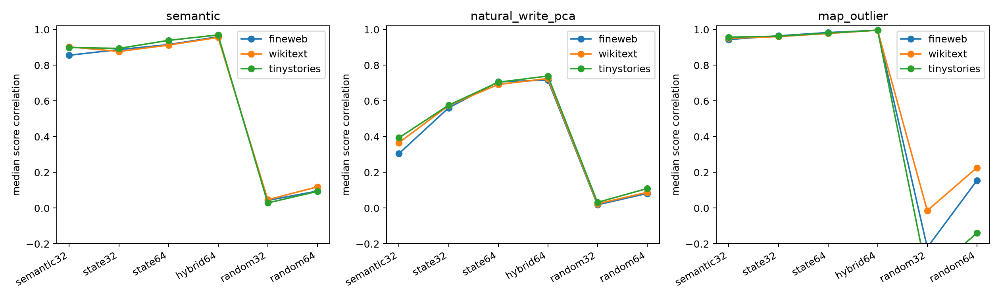

# Input-basis tradeoffs for the query interpreter

The same layer-17 bilinear MLP is projected through semantic/circuit, uncentered state-SVD, hybrid, and random input bases. This asks whether interpretability queries and whole-write reconstruction select the same equivalence class.

## Locked hypotheses

- **B1_state_basis_recovers_natural_pcs: supported.**
- **B2_semantic_basis_recovers_map_outliers: not supported.**
- **B3_hybrid_serves_both: supported.**
- **B4_hybrid_beats_random: supported.**
- **B5_objective_tradeoff: not supported.**

| Corpus | Basis | Semantic | Natural-write PCA | Map top-4 | Whole-write R² |
|---|---|---:|---:|---:|---:|
| fineweb | semantic32 | 0.856 | 0.305 | 0.944 | 0.669 |
| fineweb | state32 | 0.888 | 0.562 | 0.965 | 0.911 |
| fineweb | state64 | 0.916 | 0.707 | 0.983 | 0.941 |
| fineweb | hybrid64 | 0.959 | 0.717 | 0.996 | 0.961 |
| fineweb | random32 | 0.043 | 0.019 | -0.220 | -0.000 |
| fineweb | random64 | 0.095 | 0.082 | 0.154 | 0.001 |
| wikitext | semantic32 | 0.903 | 0.366 | 0.951 | 0.675 |
| wikitext | state32 | 0.877 | 0.574 | 0.960 | 0.902 |
| wikitext | state64 | 0.913 | 0.692 | 0.978 | 0.931 |
| wikitext | hybrid64 | 0.956 | 0.726 | 0.996 | 0.964 |
| wikitext | random32 | 0.047 | 0.024 | -0.014 | 0.000 |
| wikitext | random64 | 0.119 | 0.088 | 0.226 | 0.002 |
| tinystories | semantic32 | 0.899 | 0.394 | 0.957 | 0.682 |
| tinystories | state32 | 0.894 | 0.576 | 0.963 | 0.910 |
| tinystories | state64 | 0.939 | 0.705 | 0.980 | 0.937 |
| tinystories | hybrid64 | 0.970 | 0.740 | 0.996 | 0.962 |
| tinystories | random32 | 0.029 | 0.032 | -0.379 | -0.001 |
| tinystories | random64 | 0.093 | 0.110 | -0.140 | 0.000 |

A basis is always relative to a loss or readout family. Semantic score fidelity, high-variance write reconstruction, and full-vector reconstruction are distinct objectives even when they share some directions.
