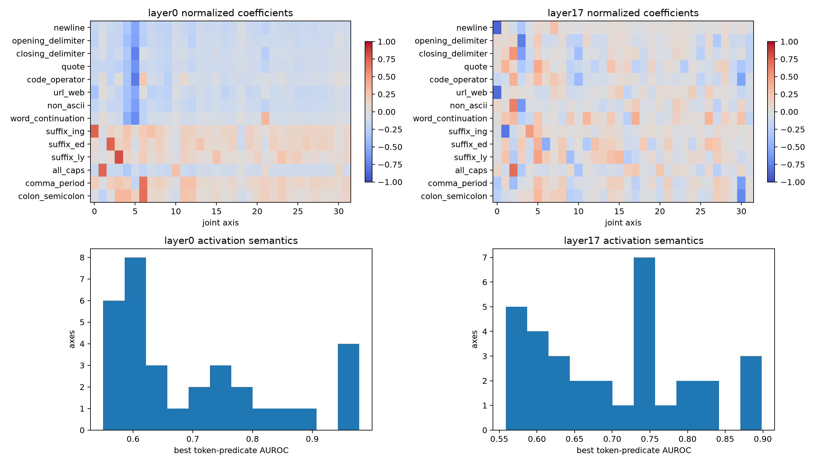

# Stable joint-axis semantic atlas

The 32 stable axes at each layer are scanned over 80,000 FineWeb positions. Axis activation is squared coordinate magnitude, matching the diagonalized quadratic representation. Coefficients cover 14 frozen token predicates; activation labels use the current token at layer 0 and next token at layer 17.

## Locked hypotheses

- **V1_layer0_axis_semantics: not supported.**
- **V2_layer17_axis_semantics: supported.**
- **V3_coefficient_concentration: not supported.**
- **V4_non_native_axes: supported.**
- **V5_coefficient_activation_agreement: not supported.**

| Layer | Semantic axes | Median best AUROC | Effective concept support | Native-factor cosine | Coefficient/activation agreement |
|---|---:|---:|---:|---:|---:|
| layer0 | 14/32 | 0.643 | 11.69 | 0.355 | 40.6% |
| layer17 | 20/32 | 0.699 | 8.62 | 0.499 | 15.6% |

Cross-depth mean best-axis overlap is **0.137**. Full coefficient profiles, AUROCs, native-factor matches, and top contexts are in `joint_axis_atlas.json`.
