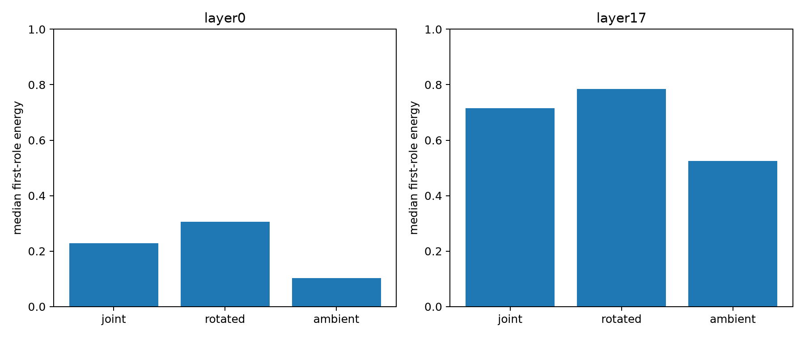

# Basis controls for contextual residual roles

The stable joint axes are compared with three random rotations of exactly the same 32D subspace and three random 32D ambient subspaces. Every condition uses the same held-out FineWeb states and random residual-write sketch.

## Locked hypotheses

- **B1_layer17_joint_rank_advantage: not supported.**
- **B2_layer0_joint_rank_advantage: not supported.**
- **B3_layer17_joint_concentration: not supported.**
- **B4_architectural_depth_gap: supported.**
- **B5_control_stability: supported.**

| Layer | Basis | First role energy | Four-role energy | Rank for 90% | Control CV |
|---|---|---:|---:|---:|---:|
| layer0 | joint | 0.229 | 0.440 | 44.0 | 0.000 |
| layer0 | rotated | 0.305 | 0.522 | 37.5 | 0.093 |
| layer0 | ambient | 0.102 | 0.262 | 52.8 | 0.045 |
| layer17 | joint | 0.715 | 0.901 | 4.5 | 0.000 |
| layer17 | rotated | 0.785 | 0.955 | 2.5 | 0.012 |
| layer17 | ambient | 0.526 | 0.674 | 32.5 | 0.018 |

Random rotations control whether the reported cleanliness comes from a particular coordinate choice; ambient controls test whether it is generic to the layer's weights. The residual sketch remains a local MLP-write measure and does not establish which write directions survive the rest of the network.
