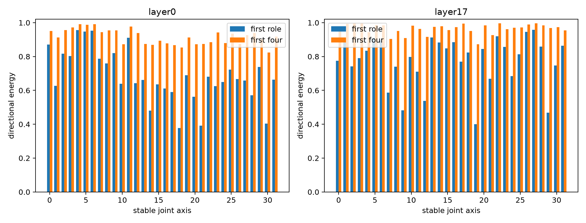

# Contextual roles of stable joint axes

For each recovered axis, this analysis exactly computes the 14-dimensional semantic-readout change caused by zeroing that coordinate. It then asks how many role directions are required across the highest-effect 10% of contexts. Sign reversals along one direction still count as one role; extra rank means the axis has genuinely different effects with different partners.

## Locked hypotheses

- **C1_layer0_rank1_roles: not supported.**
- **C2_depth_role_rank_gap: not supported.**
- **C3_low_dimensional_roles: supported.**
- **C4_ood_role_subspaces: supported.**
- **C5_diagonal_role_at_high_effect: not supported.**

| Corpus | Layer | First role energy | Four-role energy | Rank for 90% | Diagonal-role cosine |
|---|---|---:|---:|---:|---:|
| fineweb | layer0 | 0.663 | 0.915 | 4.0 | 0.823 |
| fineweb | layer17 | 0.819 | 0.974 | 2.0 | 0.648 |
| wikitext | layer0 | 0.691 | 0.921 | 4.0 | 0.820 |
| wikitext | layer17 | 0.855 | 0.977 | 2.0 | 0.633 |
| tinystories | layer0 | 0.698 | 0.946 | 3.0 | 0.810 |
| tinystories | layer17 | 0.875 | 0.984 | 2.0 | 0.658 |

## OOD role-subspace overlap

| Corpus | Layer 0 | Layer 17 |
|---|---:|---:|
| wikitext | 0.946 | 0.958 |
| tinystories | 0.950 | 0.930 |

The role basis is computed from normalized finite-effect vectors, so frequent large effects do not automatically dominate the dimensionality estimate. The vocabulary of 14 token predicates is still only a restricted semantic probe, not a complete account of each axis.
