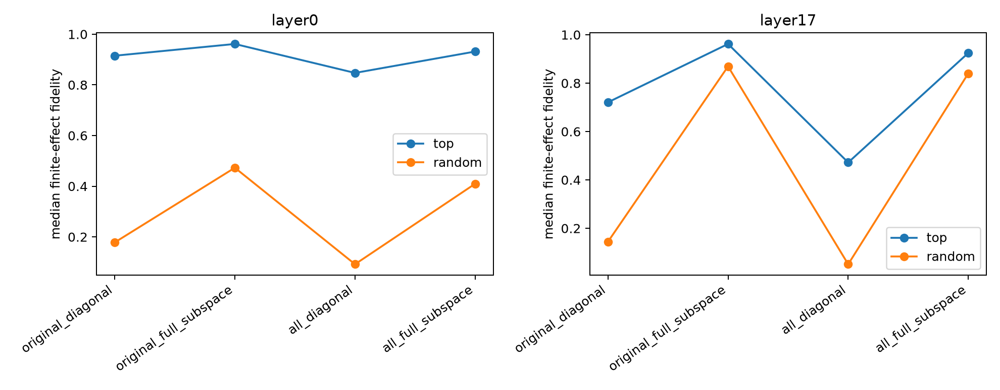

# Finite joint-axis intervention validation

Each stable coordinate is zeroed at eight top-activation and eight random FineWeb sites. Actual changes in 14 exact output-conditioned MLP scalar forms are compared with the diagonal-axis prediction and with the complete 32D interaction-matrix prediction.

## Locked hypotheses

- **I1_layer0_diagonal_execution: not supported.**
- **I2_layer17_diagonal_execution: not supported.**
- **I3_open_vocabulary_execution: not supported.**
- **I4_interaction_gain: supported.**
- **I5_activation_regime_stability: not supported.**

| Layer | Stratum | Original diagonal | Original full matrix | All-14 diagonal | All-14 full matrix |
|---|---|---:|---:|---:|---:|
| layer0 | top | 0.965 / 0.915 | 0.982 / 0.961 | 0.936 / 0.847 | 0.972 / 0.932 |
| layer0 | random | 0.544 / 0.178 | 0.736 / 0.473 | 0.399 / 0.092 | 0.697 / 0.410 |
| layer17 | top | 0.932 / 0.721 | 0.987 / 0.962 | 0.790 / 0.472 | 0.974 / 0.925 |
| layer17 | random | 0.623 / 0.144 | 0.953 / 0.869 | 0.468 / 0.051 | 0.935 / 0.841 |

Cells show median cosine / fidelity. Per-axis finite interventions are in `joint_axis_interventions.json`.
