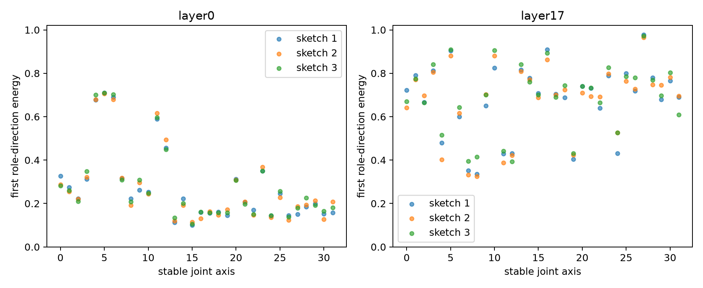

# Random-residual-sketch red-team of contextual roles

The prior contextual-role result used 14 semantic queries. This red-team instead projects each exact 1,152-dimensional MLP write change into three independent 96-dimensional random orthogonal sketches. A consistent result is evidence about residual-write geometry rather than the hand-built semantic vocabulary.

## Locked hypotheses

- **R1_depth_ordering: supported.**
- **R2_low_residual_role_rank: not supported.**
- **R3_sketch_stability: supported.**
- **R4_ood_residual_role_subspaces: supported.**
- **R5_semantic_probe_not_rank_artifact: not supported.**

| Corpus | Layer | First role energy | Four-role energy | Rank for 90% | Sketch CV |
|---|---|---:|---:|---:|---:|
| fineweb | layer0 | 0.214 | 0.421 | 48.5 | 0.025 |
| fineweb | layer17 | 0.712 | 0.903 | 4.3 | 0.007 |
| wikitext | layer0 | 0.219 | 0.441 | 43.3 | 0.008 |
| wikitext | layer17 | 0.759 | 0.919 | 3.3 | 0.001 |
| tinystories | layer0 | 0.312 | 0.536 | 36.3 | 0.012 |
| tinystories | layer17 | 0.767 | 0.943 | 2.2 | 0.004 |

| OOD corpus | Layer 0 overlap | Layer 17 overlap |
|---|---:|---:|
| wikitext | 0.779 | 0.855 |
| tinystories | 0.736 | 0.845 |

Random sketches approximately preserve residual-write geometry but are not exact decompositions of the full 1,152-dimensional space. Agreement across three sketches is the principal safeguard.
