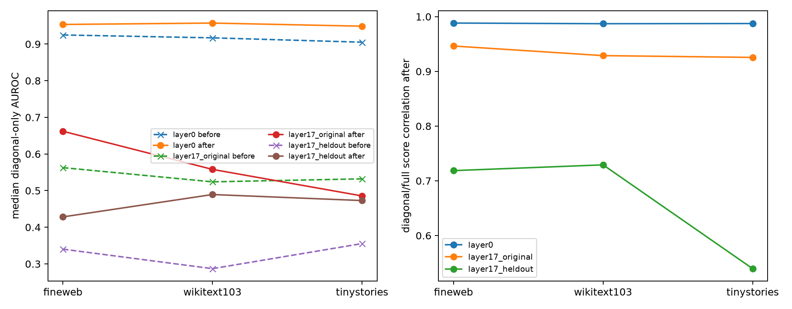

# Weight-only approximate joint diagonalization

Orthogonal rotations are optimized using only the frozen families of five weight-derived quadratic forms inside their existing 32D shared subspaces. No corpus activations enter the rotations. The layer-17 rotation is then applied unchanged to nine held-out concepts.

## Locked hypotheses

- **A1_weight_diagonalization: supported.**
- **A2_layer0_diagonal_semantics: supported.**
- **A3_layer17_diagonal_semantics: not supported.**
- **A4_heldout_diagonal_transfer: not supported.**
- **A5_score_fidelity_gain: supported.**

| Family | Initial off-diagonal energy | Final | Relative reduction |
|---|---:|---:|---:|
| layer0 | 0.386 | 0.059 | 84.8% |
| layer17 | 0.682 | 0.157 | 77.0% |

| Corpus | Family | Full AUROC | Diagonal before | Diagonal after | Correlation before | Correlation after |
|---|---|---:|---:|---:|---:|---:|
| fineweb | layer0 | 0.956 | 0.925 | 0.954 | 0.921 | 0.988 |
| fineweb | layer17_original | 0.684 | 0.563 | 0.662 | 0.658 | 0.946 |
| fineweb | layer17_heldout | 0.575 | 0.340 | 0.428 | 0.187 | 0.719 |
| wikitext103 | layer0 | 0.959 | 0.917 | 0.957 | 0.913 | 0.987 |
| wikitext103 | layer17_original | 0.721 | 0.524 | 0.558 | 0.593 | 0.929 |
| wikitext103 | layer17_heldout | 0.631 | 0.287 | 0.489 | 0.227 | 0.729 |
| tinystories | layer0 | 0.947 | 0.905 | 0.949 | 0.924 | 0.987 |
| tinystories | layer17_original | 0.654 | 0.532 | 0.486 | 0.609 | 0.926 |
| tinystories | layer17_heldout | 0.677 | 0.355 | 0.473 | 0.254 | 0.540 |

Per-concept results and optimization traces are in `joint_diagonalization.json`.
