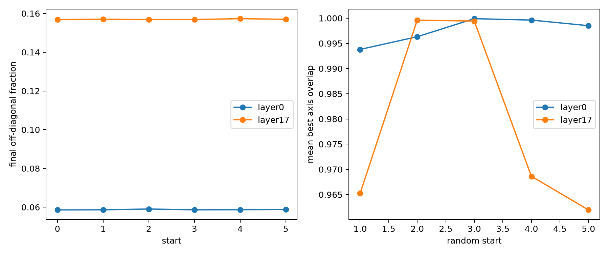

# Multi-start joint-diagonalization stability

Each family is optimized once from identity and five times from independent random skew initializations. Axis comparison quotients sign and permutation by matching absolute column overlaps to the identity-start solution. Row-best and mutual-nearest statistics are reported because no external assignment package is used.

## Locked hypotheses

- **S1_objective_stability: supported.**
- **S2_layer0_axis_recovery: supported.**
- **S3_layer17_axis_recovery: supported.**
- **S4_depth_stability_gap: not supported.**

| Family | Loss mean | Loss CV | Best-axis overlap | Mutual-nearest axes | Unique matched axes |
|---|---:|---:|---:|---:|---:|
| layer0 | 0.0587 | 0.003 | 0.998 | 100.0% | 100.0% |
| layer17 | 0.1570 | 0.001 | 0.979 | 100.0% | 100.0% |

Per-start traces and matching diagnostics are in `joint_diagonalization_stability.json`.
