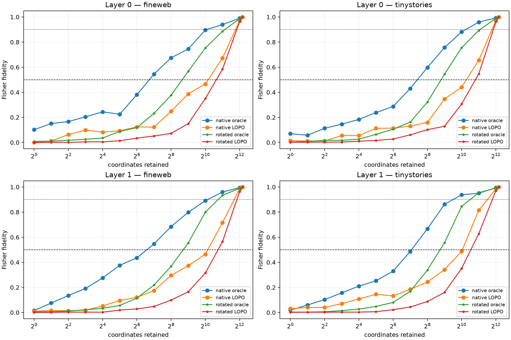

# Layer-0/1 native and rotated coordinate sufficiency frontiers

Per-example oracle and leave-one-pair-out semantic-family coordinate banks are swept from one coordinate to the complete 4,608-channel layer. Every partial product change is propagated through the nonlinear suffix and scored against the complete MLP-only patch in the native softmax-Fisher metric.

## Locked hypotheses

- **F0_full_coordinate_positive_control: supported.**
- **F1_no_tiny_family_circuit: supported.**
- **F2_individual_edits_have_moderate_native_sparsity: supported.**
- **F3_reusable_family_banks_reach_half_fidelity: not supported.**
- **F4_high_fidelity_requires_broad_native_banks: supported.**
- **F5_native_advantage_persists_at_512: supported.**
- **F6_rotation_converges_only_at_broad_rank: supported.**
- **F7_layer1_family_code_is_more_compact: not supported.**

| Layer | Corpus | Native oracle S50/S90 | Native LOPO S50/S90 | Rotated oracle S50/S90 | Rotated LOPO S50/S90 |
|---:|---|---:|---:|---:|---:|
| 0 | fineweb | 128 / 2048 | 2048 / 4096 | 512 / 4096 | 2048 / 4096 |
| 0 | tinystories | 256 / 2048 | 2048 / 4096 | 512 / 2048–4096 | 2048 / 4096 |
| 1 | fineweb | 128 / 2048 | 2048 / 4096 | 512 / 2048 | 2048 / 4096 |
| 1 | tinystories | 256 / 1024 | 2048 / 4096 | 512 / 2048 | 2048 / 4096 |

S50/S90 are the first tested coordinate budgets reaching 0.50/0.90 median Fisher fidelity. They describe the selected family of semantic edits, not the number of neurons required for all natural language behavior. A native advantage establishes basis privilege; a large native S90 establishes that basis privilege is compatible with a distributed feature.
