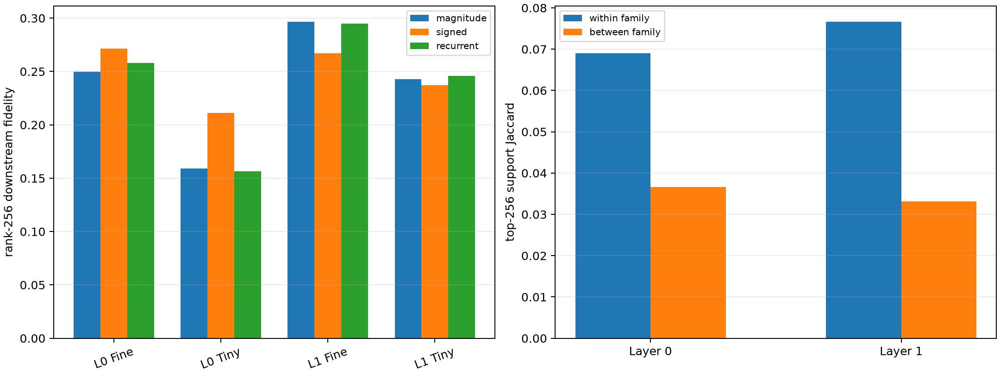

# Are broad Layer-0/1 semantic banks shared codes or unions of specialists?

For every held-out lexical pair, three rank-matched native banks are built from the other members of its semantic family: mean absolute contribution (allows heterogeneous signs), absolute signed mean (requires a shared signed effect), and recurrence-first ranking (prefers channels appearing in multiple members' top-256 sets). Each is evaluated through the nonlinear suffix.

## Locked hypotheses

- **C1_same_family_native_support_overlaps_more: supported.**
- **C2_same_family_contribution_profiles_are_closer: supported.**
- **C3_signed_common_bank_matches_magnitude_bank: supported.**
- **C4_recurrence_bank_matches_magnitude_bank: supported.**
- **C5_family_banks_contain_recurrent_channels: not supported.**
- **C6_recurrent_channels_have_consistent_sign: supported.**
- **C7_layer1_has_more_support_reuse: not supported.**
- **C8_common_banks_transfer_ood: not supported.**

| Layer | Within/between Jaccard | Within/between abs cosine | Recurrent fraction median/min | Sign agreement |
|---:|---:|---:|---:|---:|
| 0 | 0.069/0.037 | 0.385/0.107 | 0.270/0.070 | 1.000 |
| 1 | 0.077/0.033 | 0.357/0.104 | 0.254/0.059 | 1.000 |

| Layer | Corpus | Rank | Magnitude union | Signed common | Recurrence first |
|---:|---|---:|---:|---:|---:|
| 0 | fineweb | 128 | 0.122 | 0.143 | 0.174 |
| 0 | fineweb | 256 | 0.250 | 0.271 | 0.258 |
| 0 | tinystories | 128 | 0.130 | 0.131 | 0.131 |
| 0 | tinystories | 256 | 0.159 | 0.211 | 0.157 |
| 1 | fineweb | 128 | 0.175 | 0.190 | 0.180 |
| 1 | fineweb | 256 | 0.297 | 0.267 | 0.295 |
| 1 | tinystories | 128 | 0.185 | 0.185 | 0.182 |
| 1 | tinystories | 256 | 0.243 | 0.237 | 0.246 |

If signed-common and recurrence banks match the magnitude bank, the family uses genuinely shared native gates. If only the magnitude bank works, the apparent family code is better described as a union of pair-specific specialists. Support overlap alone is descriptive; finite downstream fidelity adjudicates the code.
