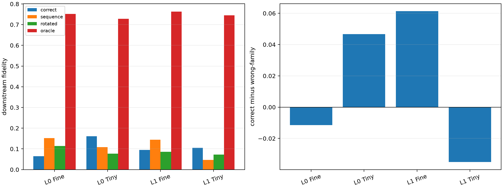

# Prospective final-position semantic banks in Layers 0 and 1

Banks are frozen on the original nineteen substitutions using only each MLP's write at the final query position and discovery contexts `[1]`. Seventeen declared new substitutions, three contexts per pair, are evaluated on FineWeb and TinyStories. The causal target is the complete final-position MLP change with all other MLP positions held at the base run.

## Locked hypotheses

- **F0_final_bank_transfers: not supported.**
- **F1_correct_family_wins: not supported.**
- **F2_final_bank_beats_sequence_bank: not supported.**
- **F3_native_basis_is_privileged: not supported.**
- **F4_oracle_gap_remains: supported.**
- **F5_ood_retention: supported.**
- **F6_scopes_share_nonrandom_but_distinct_channels: not supported.**
- **F7_final_patch_has_measurable_effect: supported.**

| Layer | Corpus | Correct / wrong / advantage (win) | Sequence bank | Global | Rotated | Oracle | Local correct | Target Fisher energy |
|---:|---|---:|---:|---:|---:|---:|---:|---:|
| 0 | fineweb | 0.064 / 0.141 / -0.011 (0.47) | 0.152 | 0.211 | 0.114 | 0.751 | 0.098 | 2.41e-06 |
| 0 | tinystories | 0.161 / 0.076 / 0.047 (0.63) | 0.109 | 0.074 | 0.077 | 0.729 | 0.106 | 1.29e-06 |
| 1 | fineweb | 0.095 / 0.084 / 0.061 (0.63) | 0.144 | 0.129 | 0.086 | 0.763 | 0.092 | 1.67e-05 |
| 1 | tinystories | 0.105 / 0.090 / -0.035 (0.45) | 0.047 | 0.120 | 0.072 | 0.745 | 0.080 | 6.46e-06 |

Final/sequence bank Jaccard by family:

- Layer 0: sentiment=0.026, gender=0.047, tense=0.067, increasing_scale=0.045, polarity=0.053
- Layer 1: sentiment=0.032, gender=0.032, tense=0.058, increasing_scale=0.032, polarity=0.047

This separates a position-local feature claim from the earlier distributed-sequence circuit claim. High oracle but weak family transfer would mean native channels are causally useful without supporting reusable semantic banks at the query position.
