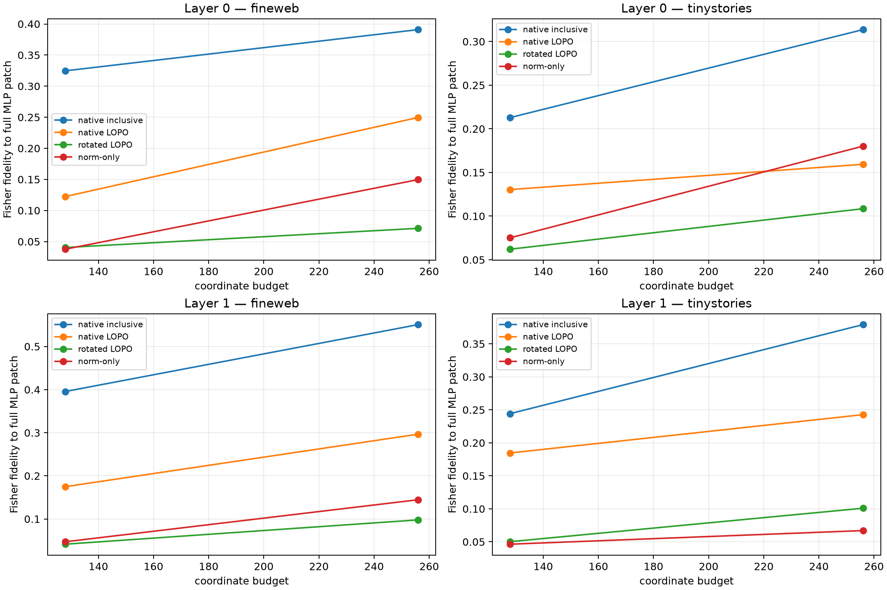

# Layer-0/1 native-axis red-team: leave-one-pair-out and norm controls

The first tournament allowed each family bank to see the evaluated lexical pair in a different context. This stricter run excludes that pair, expands the null to eight dense orthogonal rotations, and adds decoder-norm-only and decoder-norm-normalized selections. All banks remain frozen before held-out FineWeb and TinyStories evaluation through the nonlinear suffix.

## Locked hypotheses

- **R0_rotations_are_dense: supported.**
- **R1_native_lopo_banks_are_family_specific: supported.**
- **R2_native_lopo_beats_global: not supported.**
- **R3_native_axis_advantage_survives_lopo: supported.**
- **R4_axis_advantage_survives_decoder_norm_control: supported.**
- **R5_weight_norm_alone_is_insufficient: not supported.**
- **R6_same_pair_inclusion_materially_helps: supported.**
- **R7_rotation_null_is_stable: supported.**
- **R8_layer1_has_more_reusable_native_family_structure: not supported.**
- **R9_native_lopo_transfers_ood: not supported.**

| Layer | Corpus | Rank | Native inclusive | Native LOPO | Rotated LOPO | Native LOPO normed | Rotated LOPO normed | Native global | Native wrong | Native norm-only |
|---:|---|---:|---:|---:|---:|---:|---:|---:|---:|---:|
| 0 | fineweb | 128 | 0.325 | 0.122 | 0.040 | 0.160 | 0.044 | 0.175 | 0.094 | 0.038 |
| 0 | fineweb | 256 | 0.391 | 0.250 | 0.071 | 0.262 | 0.066 | 0.233 | 0.083 | 0.150 |
| 0 | tinystories | 128 | 0.213 | 0.130 | 0.062 | 0.142 | 0.058 | 0.164 | 0.023 | 0.075 |
| 0 | tinystories | 256 | 0.314 | 0.159 | 0.109 | 0.162 | 0.101 | 0.218 | 0.067 | 0.180 |
| 1 | fineweb | 128 | 0.396 | 0.175 | 0.042 | 0.175 | 0.049 | 0.114 | 0.020 | 0.047 |
| 1 | fineweb | 256 | 0.551 | 0.297 | 0.098 | 0.305 | 0.097 | 0.158 | 0.054 | 0.145 |
| 1 | tinystories | 128 | 0.244 | 0.185 | 0.050 | 0.188 | 0.055 | 0.116 | 0.020 | 0.046 |
| 1 | tinystories | 256 | 0.379 | 0.243 | 0.101 | 0.246 | 0.106 | 0.199 | 0.032 | 0.067 |

LOPO success is evidence for a family-reusable address set; inclusive-only success is merely recurrence of the same lexical edit. A native-over-rotation result after decoder-norm normalization supports architectural coordinate privilege beyond a few unusually large Down columns. It still does not imply one neuron is a complete semantic circuit.
