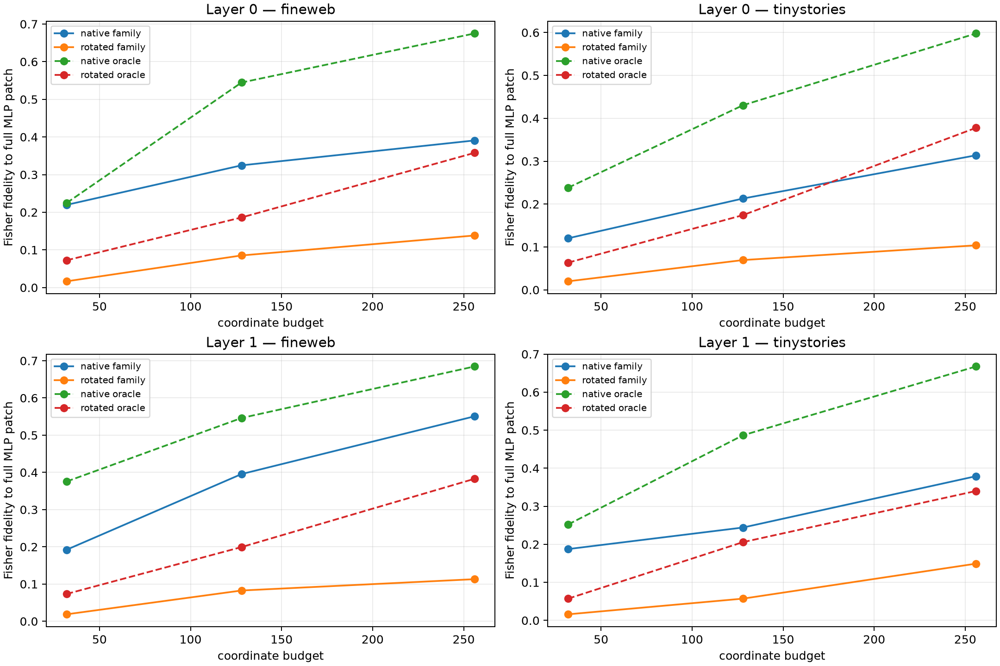

# Native-axis versus rotation causal tournament in Layers 0–1

Family-specific coordinate banks are selected on FineWeb context 1 and frozen before testing context 0 on FineWeb and TinyStories. Native product coordinates compete with two independently and densely mixed orthogonal bases. Every route patches the current example's own product change and is propagated through the full nonlinear suffix.

## Locked hypotheses

- **T0_rotation_is_an_exact_change_of_basis: supported.**
- **T1_layer0_native_family_axes_are_privileged: supported.**
- **T2_native_privilege_weakens_by_layer1: not supported.**
- **T3_native_family_banks_are_specific: supported.**
- **T4_rotated_family_banks_retain_specificity: supported.**
- **T5_family_banks_transfer_ood: not supported.**
- **T6_layer0_native_oracle_is_sparser: supported.**
- **T7_layer1_requires_context_routing: supported.**
- **T8_rotated_family_selection_is_not_random: supported.**
- **T9_small_native_banks_are_useful: not supported.**

| Layer | Corpus | Rank | Native oracle | Rotated oracle | Native family | Rotated family | Native wrong | Rotated wrong | Native random | Rotated random |
|---:|---|---:|---:|---:|---:|---:|---:|---:|---:|---:|
| 0 | fineweb | 32 | 0.225 | 0.073 | 0.220 | 0.017 | 0.016 | 0.012 | 0.009 | -0.003 |
| 0 | fineweb | 128 | 0.545 | 0.186 | 0.325 | 0.085 | 0.094 | 0.027 | 0.017 | 0.012 |
| 0 | fineweb | 256 | 0.675 | 0.358 | 0.391 | 0.138 | 0.083 | 0.054 | 0.036 | 0.034 |
| 0 | tinystories | 32 | 0.238 | 0.064 | 0.120 | 0.020 | 0.012 | 0.010 | 0.003 | 0.009 |
| 0 | tinystories | 128 | 0.430 | 0.174 | 0.213 | 0.069 | 0.023 | 0.019 | 0.015 | 0.040 |
| 0 | tinystories | 256 | 0.598 | 0.378 | 0.314 | 0.104 | 0.067 | 0.049 | 0.003 | 0.043 |
| 1 | fineweb | 32 | 0.376 | 0.073 | 0.192 | 0.019 | 0.008 | 0.014 | 0.000 | 0.004 |
| 1 | fineweb | 128 | 0.546 | 0.199 | 0.396 | 0.083 | 0.020 | 0.038 | 0.026 | 0.027 |
| 1 | fineweb | 256 | 0.685 | 0.383 | 0.551 | 0.113 | 0.054 | 0.041 | 0.086 | 0.035 |
| 1 | tinystories | 32 | 0.252 | 0.057 | 0.188 | 0.016 | 0.003 | 0.003 | -0.004 | 0.008 |
| 1 | tinystories | 128 | 0.487 | 0.206 | 0.244 | 0.057 | 0.020 | 0.026 | 0.018 | 0.012 |
| 1 | tinystories | 256 | 0.668 | 0.340 | 0.379 | 0.149 | 0.032 | 0.026 | 0.039 | 0.043 |

Maximum full-coordinate rotation reconstruction error: **2.651e-06**.

A native advantage means the architectural product coordinates give a shorter causal description than a matched coordinate change. Rotated-family success still indicates reusable family structure, but locates it at the subspace/distributed-code level. The oracle/frozen gap measures context-dependent routing rather than semantic coherence by itself.
