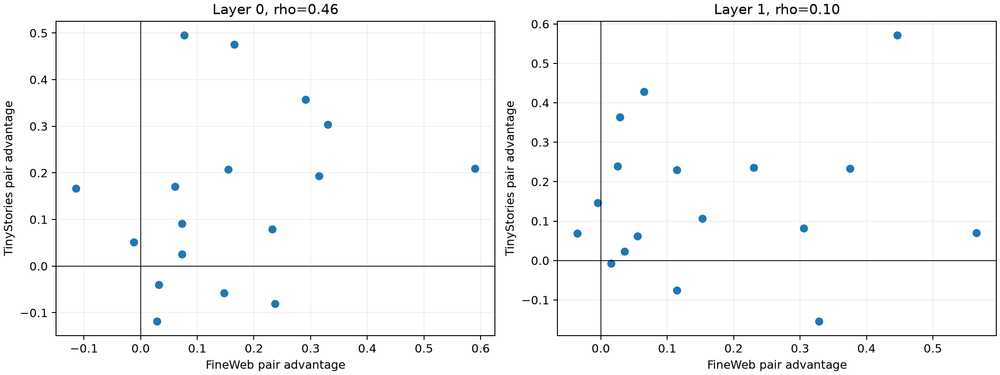

# Pair-clustered red-team of prospective Layer-0/1 semantic banks

The three contexts for each of seventeen new lexical substitutions are aggregated before inference. Pair-bootstrap intervals, size-preserving family-label permutations, top-1 bank classification, per-family replication, and cross-corpus pair consistency test whether the example-level result was inflated by correlated contexts.

## Locked hypotheses

- **R0_pair_clustered_advantage_is_material: supported.**
- **R1_most_pairs_prefer_correct_family: supported.**
- **R2_correct_bank_is_often_top1: not supported.**
- **R3_family_mapping_beats_permutation: supported.**
- **R4_bootstrap_interval_excludes_zero: supported.**
- **R5_pair_difficulty_is_cross_corpus_stable: not supported.**
- **R6_result_is_not_one_family: supported.**
- **R7_strict_core_is_pairwise_positive: supported.**

| Layer | Corpus | Median advantage (95% pair bootstrap) | Pair win | Top-1 family | Null p99 / p | Strict positive |
|---:|---|---:|---:|---:|---:|---:|
| 0 | fineweb | 0.147 (0.061, 0.237) | 0.882 | 0.647 | 0.073 / 0.0004 | 0.882 |
| 0 | tinystories | 0.167 (0.025, 0.209) | 0.765 | 0.529 | 0.095 / 0.0002 | 0.824 |
| 1 | fineweb | 0.115 (0.029, 0.306) | 0.882 | 0.529 | 0.065 / 0.0004 | 0.941 |
| 1 | tinystories | 0.106 (0.062, 0.236) | 0.824 | 0.412 | 0.071 / 0.0006 | 0.941 |

Cross-corpus pair-advantage Spearman: Layer 0 **0.461**; Layer 1 **0.096**.

Permutation significance tests the declared family mapping, not whether the family names are the only possible abstraction. A generic bank can remain competitive even when the correct named bank reliably beats wrong named banks.
