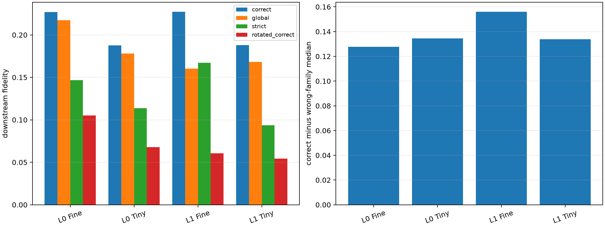

# Prospective Layer-0/1 native-bank transfer to seventeen new lexical pairs

All native, signed, strict-recurrent, global, and rotated banks are frozen from the original nineteen substitutions. They are evaluated on seventeen previously declared new substitutions, three independently selected contexts per pair, on FineWeb and TinyStories. No new-pair effect enters bank selection.

## Locked hypotheses

- **P0_native_family_banks_transfer_to_new_pairs: supported.**
- **P1_correct_family_wins_most_examples: supported.**
- **P2_layer1_family_bank_beats_global: not supported.**
- **P3_layer0_is_primarily_generic: supported.**
- **P4_strict_recurrent_core_transfers: supported.**
- **P5_strict_core_retains_half_of_family_bank: not supported.**
- **P6_signed_common_bank_matches_magnitude: supported.**
- **P7_native_axis_advantage_transfers: supported.**
- **P8_oracle_gap_persists: supported.**
- **P9_new_pair_effect_transfers_ood: supported.**

| Layer | Corpus | Correct | Wrong | Advantage/win | Global | Signed | Strict (size) | Rotated correct | Oracle |
|---:|---|---:|---:|---:|---:|---:|---:|---:|---:|
| 0 | fineweb | 0.227 | 0.080 | 0.128/0.80 | 0.217 | 0.223 | 0.147 (116) | 0.105 | 0.651 |
| 0 | tinystories | 0.188 | 0.066 | 0.134/0.76 | 0.178 | 0.165 | 0.114 (116) | 0.068 | 0.646 |
| 1 | fineweb | 0.227 | 0.070 | 0.156/0.80 | 0.160 | 0.231 | 0.167 (109) | 0.061 | 0.648 |
| 1 | tinystories | 0.188 | 0.063 | 0.134/0.76 | 0.168 | 0.180 | 0.094 (109) | 0.054 | 0.661 |

Correct-versus-wrong tests semantic family specificity. Correct-versus-global tests whether the family label improves on a generic lexical-edit bank. Native-versus-rotated tests coordinate privilege. Strict-core fidelity tests the small shared kernel; oracle distance measures the remaining context-specific tail.
