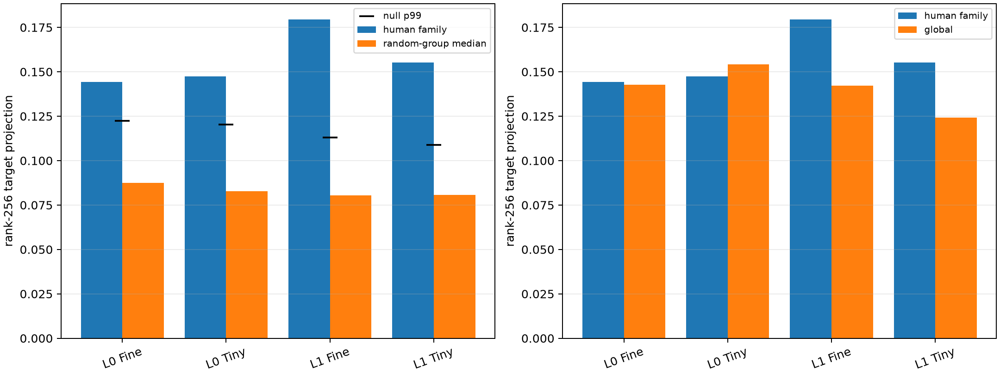

# Do human semantic families predict native Layer-0/1 channel banks?

For each held-out lexical pair, the native bank is selected from the other pairs in its declared family. Its exact additive projection onto the current MLP-write change is compared with 2,000 size-matched random regroupings of the same 19 edits. No permuted bank sees the held-out pair. Decoder-norm-normalized selection, a global bank, and a target-informed nearest-pair oracle are controls.

## Locked hypotheses

- **G1_layer1_human_families_beat_random_groups: supported.**
- **G2_layer0_human_families_beat_random_groups: supported.**
- **G3_semantic_grouping_emerges_by_layer1: not supported.**
- **G4_layer1_human_families_beat_global: supported.**
- **G5_family_advantage_transfers_ood: supported.**
- **G6_semantic_grouping_survives_decoder_norm_control: supported.**
- **G7_pair_similarity_oracle_beats_human_family: not supported.**

| Layer | Corpus | Rank | Human family | Null median / p95 / p99 | p | Normed family / null p95 | Global | Nearest-pair oracle |
|---:|---|---:|---:|---:|---:|---:|---:|---:|
| 0 | fineweb | 128 | 0.109 | 0.050 / 0.071 / 0.087 | 0.0005 | 0.110 / 0.071 | 0.102 | 0.112 |
| 0 | fineweb | 256 | 0.144 | 0.087 / 0.110 / 0.123 | 0.0010 | 0.144 / 0.109 | 0.143 | 0.159 |
| 0 | tinystories | 128 | 0.109 | 0.046 / 0.075 / 0.088 | 0.0005 | 0.110 / 0.074 | 0.099 | 0.106 |
| 0 | tinystories | 256 | 0.148 | 0.083 / 0.110 / 0.120 | 0.0005 | 0.147 / 0.109 | 0.154 | 0.147 |
| 1 | fineweb | 128 | 0.132 | 0.045 / 0.064 / 0.073 | 0.0005 | 0.123 / 0.063 | 0.095 | 0.132 |
| 1 | fineweb | 256 | 0.179 | 0.080 / 0.102 / 0.113 | 0.0005 | 0.182 / 0.100 | 0.142 | 0.179 |
| 1 | tinystories | 128 | 0.119 | 0.046 / 0.061 / 0.069 | 0.0005 | 0.119 / 0.061 | 0.085 | 0.125 |
| 1 | tinystories | 256 | 0.155 | 0.081 / 0.100 / 0.109 | 0.0005 | 0.157 / 0.099 | 0.124 | 0.158 |

The projection is the exact sum of selected channels' signed inner products with the full MLP-write change, divided by full-write squared norm. It is additive and inexpensive enough for permutation testing, but unlike finite downstream fidelity it does not penalize orthogonal write energy. Conclusions should therefore require agreement with the preceding finite LOPO experiment.
