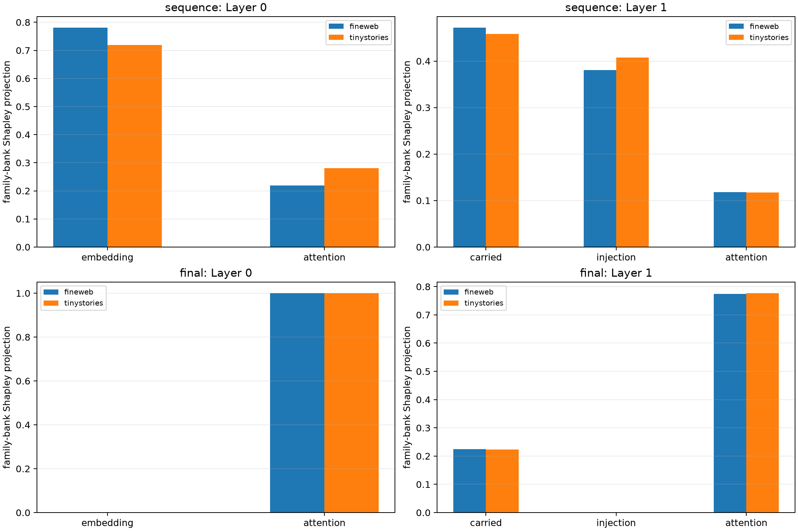

# Exact boundary-source factorial for prospective Layer-0/1 semantic banks

At each MLP boundary the counterfactual pre-MLP change is decomposed additively. Layer 0 uses embedding-mix and local-attention changes; Layer 1 uses carried Layer-0 output, direct repeated-embedding injection, and local attention. Every coalition is passed through RMSNorm and the native bilinear MLP. Shapley values attribute the complete write, rank-256 family bank, and strict recurrent core.

## Two legitimate spatial scopes

The preregistered primary scope decodes the distributed write through prediction position `63`, matching how the family banks were discovered and patched. The diagnostic scope decodes only position `63`. The substituted token is at position `47`. These answer different questions: **where the edit is represented across the sequence** versus **what reaches the query position**.

At the final position, the direct embedding-delta terms are exactly zero by causal layout: that token's identity was not changed. Consequently, Layer-0 attention sufficiency and zero direct-injection attribution there are architectural controls, not discoveries that embeddings are globally unimportant. Attention is itself an endogenous function of embedding/current states and QKOV weights.

## Locked hypotheses (distributed-sequence scope)

- **A0_boundary_factorial_is_exact: supported.**
- **A1_layer0_family_bank_is_embedding_dominated: supported.**
- **A2_layer0_attention_is_material: supported.**
- **A3_layer1_family_bank_is_carried_state_dominated: not supported.**
- **A4_layer1_direct_injection_is_a_minor_source: not supported.**
- **A5_layer1_attention_is_material: supported.**
- **A6_strict_core_is_more_source_concentrated: not supported.**
- **A7_source_attribution_transfers_ood: supported.**
- **A8_no_single_boundary_source_is_sufficient: supported.**

| Scope | Layer | Corpus | Target | Source | Shapley projection | Energy ratio | Source-alone fidelity |
|---|---:|---|---|---|---:|---:|---:|
| sequence | 0 | fineweb | full | embedding | 0.663 | 0.692 | 0.609 |
| sequence | 0 | fineweb | full | attention | 0.337 | 0.368 | 0.276 |
| sequence | 0 | fineweb | family | embedding | 0.781 | 0.845 | 0.701 |
| sequence | 0 | fineweb | family | attention | 0.219 | 0.272 | 0.155 |
| sequence | 0 | fineweb | strict | embedding | 0.810 | 0.872 | 0.719 |
| sequence | 0 | fineweb | strict | attention | 0.190 | 0.243 | 0.127 |
| final | 0 | fineweb | full | embedding | 0.000 | 0.000 | 0.000 |
| final | 0 | fineweb | full | attention | 1.000 | 1.000 | 1.000 |
| final | 0 | fineweb | family | embedding | 0.000 | 0.000 | 0.000 |
| final | 0 | fineweb | family | attention | 1.000 | 1.000 | 1.000 |
| final | 0 | fineweb | strict | embedding | 0.000 | 0.000 | 0.000 |
| final | 0 | fineweb | strict | attention | 1.000 | 1.000 | 1.000 |
| sequence | 0 | tinystories | full | embedding | 0.601 | 0.611 | 0.569 |
| sequence | 0 | tinystories | full | attention | 0.399 | 0.408 | 0.360 |
| sequence | 0 | tinystories | family | embedding | 0.719 | 0.754 | 0.664 |
| sequence | 0 | tinystories | family | attention | 0.281 | 0.319 | 0.186 |
| sequence | 0 | tinystories | strict | embedding | 0.744 | 0.803 | 0.691 |
| sequence | 0 | tinystories | strict | attention | 0.256 | 0.299 | 0.188 |
| final | 0 | tinystories | full | embedding | 0.000 | 0.000 | 0.000 |
| final | 0 | tinystories | full | attention | 1.000 | 1.000 | 1.000 |
| final | 0 | tinystories | family | embedding | 0.000 | 0.000 | 0.000 |
| final | 0 | tinystories | family | attention | 1.000 | 1.000 | 1.000 |
| final | 0 | tinystories | strict | embedding | 0.000 | 0.000 | 0.000 |
| final | 0 | tinystories | strict | attention | 1.000 | 1.000 | 1.000 |
| sequence | 1 | fineweb | full | carried | 0.457 | 0.336 | 0.524 |
| sequence | 1 | fineweb | full | injection | 0.286 | 0.187 | 0.388 |
| sequence | 1 | fineweb | full | attention | 0.232 | 0.251 | 0.253 |
| sequence | 1 | fineweb | family | carried | 0.472 | 0.306 | 0.535 |
| sequence | 1 | fineweb | family | injection | 0.380 | 0.247 | 0.461 |
| sequence | 1 | fineweb | family | attention | 0.118 | 0.121 | 0.139 |
| sequence | 1 | fineweb | strict | carried | 0.458 | 0.300 | 0.518 |
| sequence | 1 | fineweb | strict | injection | 0.423 | 0.249 | 0.488 |
| sequence | 1 | fineweb | strict | attention | 0.097 | 0.108 | 0.108 |
| final | 1 | fineweb | full | carried | 0.233 | 0.220 | 0.243 |
| final | 1 | fineweb | full | injection | 0.000 | 0.000 | 0.000 |
| final | 1 | fineweb | full | attention | 0.767 | 0.756 | 0.778 |
| final | 1 | fineweb | family | carried | 0.225 | 0.211 | 0.212 |
| final | 1 | fineweb | family | injection | 0.000 | 0.000 | 0.000 |
| final | 1 | fineweb | family | attention | 0.775 | 0.789 | 0.790 |
| final | 1 | fineweb | strict | carried | 0.208 | 0.202 | 0.196 |
| final | 1 | fineweb | strict | injection | 0.000 | 0.000 | 0.000 |
| final | 1 | fineweb | strict | attention | 0.792 | 0.803 | 0.797 |
| sequence | 1 | tinystories | full | carried | 0.458 | 0.338 | 0.549 |
| sequence | 1 | tinystories | full | injection | 0.307 | 0.213 | 0.376 |
| sequence | 1 | tinystories | full | attention | 0.212 | 0.226 | 0.238 |
| sequence | 1 | tinystories | family | carried | 0.458 | 0.288 | 0.539 |
| sequence | 1 | tinystories | family | injection | 0.408 | 0.255 | 0.492 |
| sequence | 1 | tinystories | family | attention | 0.117 | 0.130 | 0.145 |
| sequence | 1 | tinystories | strict | carried | 0.465 | 0.283 | 0.511 |
| sequence | 1 | tinystories | strict | injection | 0.433 | 0.265 | 0.512 |
| sequence | 1 | tinystories | strict | attention | 0.097 | 0.116 | 0.108 |
| final | 1 | tinystories | full | carried | 0.215 | 0.235 | 0.207 |
| final | 1 | tinystories | full | injection | 0.000 | 0.000 | 0.000 |
| final | 1 | tinystories | full | attention | 0.785 | 0.792 | 0.764 |
| final | 1 | tinystories | family | carried | 0.223 | 0.251 | 0.204 |
| final | 1 | tinystories | family | injection | 0.000 | 0.000 | 0.000 |
| final | 1 | tinystories | family | attention | 0.777 | 0.796 | 0.748 |
| final | 1 | tinystories | strict | carried | 0.231 | 0.221 | 0.258 |
| final | 1 | tinystories | strict | injection | 0.000 | 0.000 | 0.000 |
| final | 1 | tinystories | strict | attention | 0.769 | 0.741 | 0.777 |

Maximum source/Shapley recomposition error: **9.539e-07**.

This is an exact finite factorial at the declared MLP boundary. The attention vector is treated as one additive boundary source; the experiment does not claim that attention is independent of the embedding or carried state upstream. Source projection allocates the target write, while source-alone fidelity asks whether the corresponding hybrid boundary state is sufficient.
