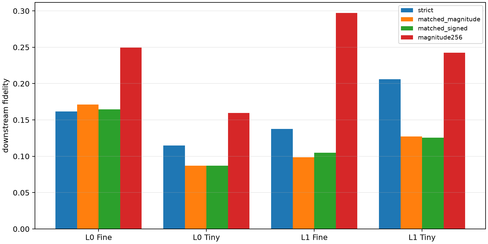

# Strict recurrent semantic cores in Layers 0–1

Only channels appearing in the top-256 contribution sets of at least two leave-one-pair-out discovery members are retained. Their variable-size finite effect is compared with equal-size magnitude and signed-mean banks, plus the complete 256-channel magnitude bank.

## Locked hypotheses

- **S1_strict_core_captures_half_of_bank_effect: not supported.**
- **S2_recurrence_beats_equal_size_magnitude: not supported.**
- **S3_strict_core_has_positive_ood_effect: supported.**
- **S4_layer1_strict_core_is_stronger: not supported.**
- **S5_strict_core_is_small: supported.**

| Layer | Core size median/min/max | Corpus | Strict recurrent | Equal-size magnitude | Equal-size signed | Magnitude-256 |
|---:|---:|---|---:|---:|---:|---:|
| 0 | 69/18/158 | fineweb | 0.162 | 0.171 | 0.165 | 0.250 |
| 0 | 69/18/158 | tinystories | 0.115 | 0.087 | 0.087 | 0.159 |
| 1 | 65/15/170 | fineweb | 0.138 | 0.099 | 0.105 | 0.297 |
| 1 | 65/15/170 | tinystories | 0.206 | 0.127 | 0.126 | 0.243 |

A positive strict-core effect establishes genuinely recurring native gates. Equal-size magnitude is the important control: if it performs equally well, recurrence is descriptive rather than a uniquely privileged selection rule. The remainder of the 256-channel family bank is pair- or context-specific even when the strict core transfers.
