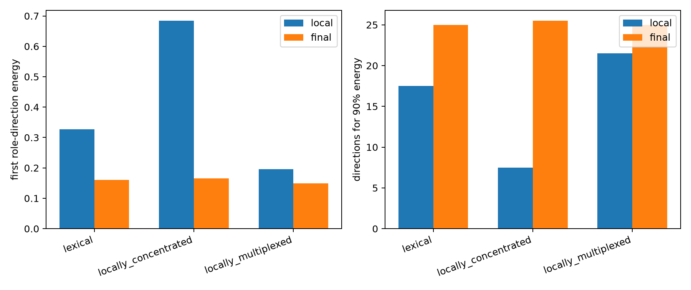

# Do layer-0 contextual roles survive downstream?

Twelve predeclared layer-0 joint axes are zeroed at 32 high-local-effect final-token sites each. The changed layer-0 MLP write is propagated through blocks 1–17. Directional rank is compared for the immediate 1,152D write and the final normalized residual state.

## Locked hypotheses

- **P1_downstream_rank_collapse: not supported.**
- **P2_low_dimensional_final_roles: not supported.**
- **P3_depth_concentrates_each_group: not supported.**
- **P4_effects_reach_predictions: supported.**
- **P5_not_every_axis_is_rank1: supported.**

| Group | Local first / four | Local rank90 | Final first / four | Final rank90 |
|---|---:|---:|---:|---:|
| lexical | 0.327 / 0.576 | 17.5 | 0.160 / 0.367 | 25.0 |
| locally_concentrated | 0.684 / 0.841 | 7.5 | 0.165 / 0.326 | 25.5 |
| locally_multiplexed | 0.196 / 0.461 | 21.5 | 0.149 / 0.377 | 25.0 |

Across 384 finite interventions, median next-token KL is 0.000119 and median absolute correct-token logit change is 0.017.

This is a selected high-effect panel at the final sequence position. It tests downstream survival of local role complexity, not average axis use or effects transmitted from earlier source positions through attention.
