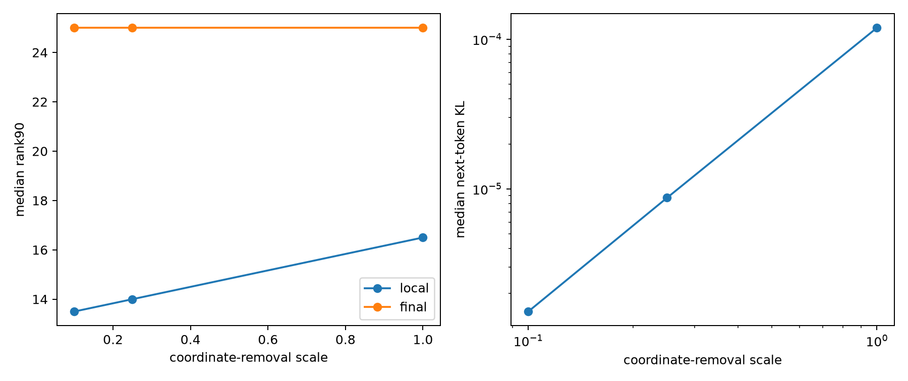

# Scale red-team of layer-0 downstream role complexity

The identical 384 selected axis/site pairs are rerun at 10%, 25%, and 100% coordinate removal. This distinguishes context-dependent downstream Jacobians from complexity created only by large nonlinear edits.

## Locked hypotheses

- **S1_tangent_rank_survives: supported.**
- **S2_final_rank_scale_stability: supported.**
- **S3_direction_scale_stability: supported.**
- **S4_local_kl_scaling: supported.**

| Scale | Local first / four | Local rank90 | Final first / four | Final rank90 | Median KL |
|---:|---:|---:|---:|---:|---:|
| 0.10 | 0.545 / 0.729 | 13.5 | 0.143 / 0.360 | 25.0 | 1.52e-06 |
| 0.25 | 0.513 / 0.706 | 14.0 | 0.142 / 0.358 | 25.0 | 8.72e-06 |
| 1.00 | 0.327 / 0.585 | 16.5 | 0.160 / 0.365 | 25.0 | 0.000119 |

Median final-effect direction cosine between 10% and 100% removal is 0.939; the median-KL scale exponent is 1.90.
