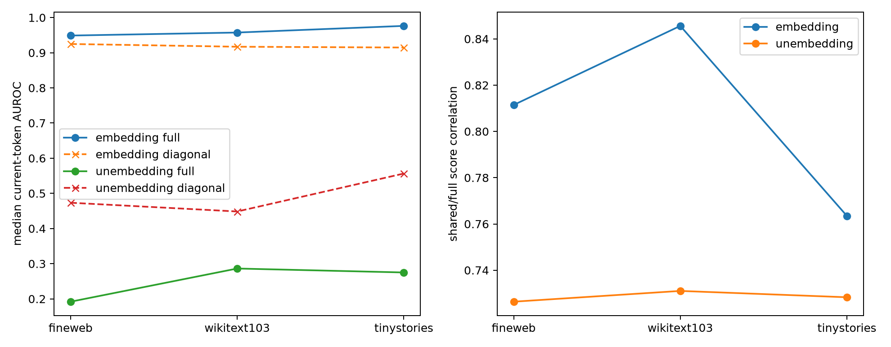

# Layer-0 joint quadratic forms under two readout definitions

The exact layer-0 bilinear tensor is conditioned either on token-embedding class contrasts (an identity-facing residual query) or on unembedding contrasts (a logit-facing query). Current-token labels are evaluated on all three corpora.

## Locked hypotheses

- **Z1_embedding_semantics: supported.**
- **Z2_early_joint_diagonalization: not supported.**
- **Z3_embedding_diagonal_sufficiency: not supported.**
- **Z4_embedding_score_fidelity: supported.**
- **Z5_readout_dependence: supported.**

| Readout | Form effective rank | Median commutator | Rank-4 overlap | Shared-32 energy | Cross-term fraction |
|---|---:|---:|---:|---:|---:|
| embedding | 3.74 | 0.045 | 0.131 | 0.207 | 0.381 |
| unembedding | 4.18 | 0.044 | 0.240 | 0.093 | 0.267 |

| Corpus | Readout | Full AUROC | Shared-32 AUROC | Diagonal AUROC | Score correlation | Centered R² |
|---|---|---:|---:|---:|---:|---:|
| fineweb | embedding | 0.949 | 0.956 | 0.925 | 0.811 | 0.594 |
| fineweb | unembedding | 0.192 | 0.129 | 0.473 | 0.726 | 0.496 |
| wikitext103 | embedding | 0.957 | 0.959 | 0.917 | 0.846 | 0.615 |
| wikitext103 | unembedding | 0.286 | 0.104 | 0.448 | 0.731 | 0.468 |
| tinystories | embedding | 0.976 | 0.983 | 0.915 | 0.763 | 0.553 |
| tinystories | unembedding | 0.275 | 0.149 | 0.556 | 0.728 | 0.482 |

Per-category results and both form families are in `layer0_joint_forms.json`.
