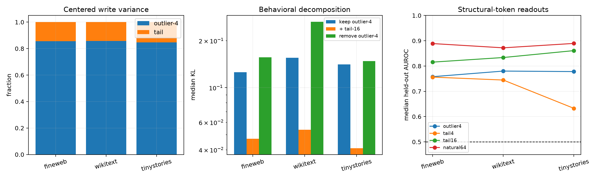

# Layer-17 spectral bottleneck and contextual-tail ontology

The four output directions are frozen from the complete bilinear weight tensor. A 16,000-site FineWeb panel supplies only the write mean and residual-tail basis. Disjoint FineWeb, WikiText, and TinyStories panels test variance, simple structural-token readouts, and exact post-MLP interventions through final RMSNorm and the unembedding.

## Locked hypotheses

- **B1_weight_outliers_match_natural_bottleneck: supported.**
- **B2_outlier_only_is_behaviorally_sufficient: not supported.**
- **B3_outliers_plus_tail16_are_near_sufficient: not supported.**
- **B4_outlier_removal_is_more_damaging_than_tail_removal: not supported.**
- **B5_tail16_is_cross_corpus_stable: supported.**
- **B6_tail16_beats_norm_matched_random_edits: not supported.**
- **B7_outlier_subspace_has_recurrent_next_token_roles: supported.**
- **B8_tail_subspace_has_recurrent_next_token_roles: supported.**

| Corpus | Outlier-4 variance efficiency | Total variance in outlier / tail | Tail eff. rank | Tail-16 transfer cosine / efficiency |
|---|---:|---:|---:|---:|
| fineweb | 0.939 | 0.856 / 0.144 | 6.2 | 0.971 / 0.993 |
| wikitext | 0.935 | 0.857 / 0.143 | 5.1 | 0.874 / 0.970 |
| tinystories | 0.909 | 0.847 / 0.153 | 4.2 | 0.825 / 0.944 |

| Corpus | Keep outlier-4 KL | Keep outlier-4 + tail-16 KL | Remove outlier-4 KL | Remove tail-16 KL | Norm-matched random KL |
|---|---:|---:|---:|---:|---:|
| fineweb | 0.12575 | 0.04702 | 0.15674 | 0.05798 | 0.04445 |
| wikitext | 0.15563 | 0.05367 | 0.26446 | 0.08022 | 0.05883 |
| tinystories | 0.14102 | 0.04095 | 0.14818 | 0.07941 | 0.04593 |

| Corpus | Outlier-4 median structural AUROC | Tail-4 | Tail-16 | Natural-64 |
|---|---:|---:|---:|---:|
| fineweb | 0.758 | 0.756 | 0.816 | 0.889 |
| wikitext | 0.780 | 0.745 | 0.834 | 0.872 |
| tinystories | 0.778 | 0.633 | 0.861 | 0.889 |

Recurrent next-token roles decoded from outlier-4: **next/newline, next/suffix_ed, next/word_continuation**.
Recurrent next-token roles decoded from tail-16: **next/comma_period, next/newline, next/suffix_ed, next/word_continuation**.

`outlier_only` and `outlier_plus_tail16` are output-write replacements around the frozen FineWeb mean, not input-side replacements. `tail_only` removes the four-dimensional outlier component. The random-16 edit is matched per site to the removed tail-16 output norm, but is off-manifold; it controls output sensitivity rather than serving as another native circuit. Variance, semantic decodability, causal necessity, and behavioral sufficiency are therefore reported as separate definitions of importance.
