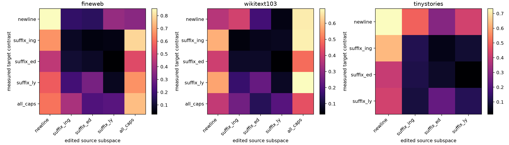

# Layer-17 cross-category spectral red-team

Each target class is tested against every category's rank-4 output-conditioned subspace. Fixed-norm edits are exactly 10% of the local MLP-input norm; natural ablations remove only the projection already present. Assignment tests ask whether the diagonal pairing is globally exceptional.

## Locked hypotheses

- **X1_fixed_norm_assignment: not supported.**
- **X2_fixed_norm_row_wins: not supported.**
- **X3_selectivity_assignment: not supported.**
- **X4_natural_ablation_assignment: not supported.**
- **X5_random_positive_assignment: not supported.**

| Corpus | Eligible | High fixed p | Row wins | High selectivity p | Natural-ablation p | Random-positive p |
|---|---:|---:|---:|---:|---:|---:|
| fineweb | 5 | 0.4417 | 2 | 0.9583 | 0.0500 | 0.0833 |
| wikitext103 | 5 | 1.0000 | 1 | 1.0000 | 0.4500 | 0.7333 |
| tinystories | 4 | 0.5000 | 1 | 0.7917 | 0.2500 | 0.6250 |

Full matrices and per-site interventions are in `layer17_cross_category.json`.
