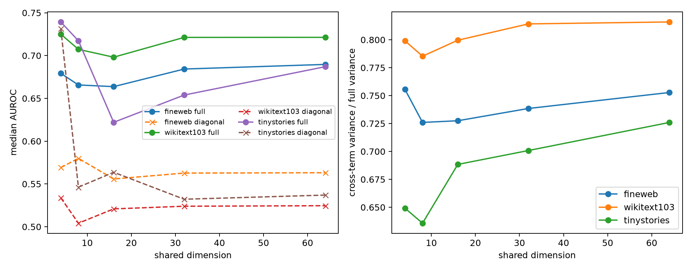

# Layer-17 diagonal-only shared-basis red-team

The shared joint-form basis is frozen. This test deletes every off-diagonal coefficient, leaving only squared scalar coordinates, and asks whether language-state semantic prediction survives.

## Locked hypotheses

- **Q1_diagonal4_sufficiency: not supported.**
- **Q2_diagonal32_sufficiency: not supported.**
- **Q3_cross_term_state_variance: supported.**
- **Q4_cross_term_semantic_gain: supported.**

| Corpus | Dim | Full AUROC | Diagonal AUROC | Cross-only AUROC | Cross variance / full | Diagonal/full correlation |
|---|---:|---:|---:|---:|---:|---:|
| fineweb | 4 | 0.679 | 0.569 | 0.670 | 0.756 | 0.632 |
| fineweb | 8 | 0.666 | 0.580 | 0.656 | 0.726 | 0.729 |
| fineweb | 16 | 0.664 | 0.556 | 0.671 | 0.727 | 0.677 |
| fineweb | 32 | 0.684 | 0.563 | 0.741 | 0.738 | 0.658 |
| fineweb | 64 | 0.690 | 0.563 | 0.746 | 0.753 | 0.633 |
| wikitext103 | 4 | 0.725 | 0.534 | 0.637 | 0.799 | 0.535 |
| wikitext103 | 8 | 0.707 | 0.504 | 0.744 | 0.785 | 0.625 |
| wikitext103 | 16 | 0.698 | 0.521 | 0.732 | 0.800 | 0.592 |
| wikitext103 | 32 | 0.721 | 0.524 | 0.754 | 0.814 | 0.593 |
| wikitext103 | 64 | 0.721 | 0.525 | 0.754 | 0.816 | 0.596 |
| tinystories | 4 | 0.739 | 0.731 | 0.570 | 0.649 | 0.763 |
| tinystories | 8 | 0.717 | 0.546 | 0.605 | 0.636 | 0.695 |
| tinystories | 16 | 0.622 | 0.564 | 0.515 | 0.688 | 0.641 |
| tinystories | 32 | 0.654 | 0.532 | 0.563 | 0.701 | 0.609 |
| tinystories | 64 | 0.687 | 0.537 | 0.595 | 0.726 | 0.577 |

Per-category results are in `layer17_diagonal_redteam.json`.
