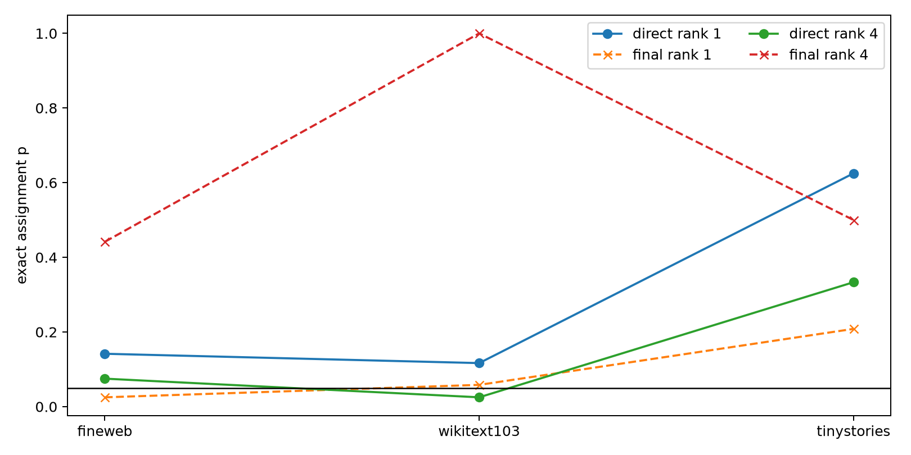

# Layer-17 direct-write versus end-to-end specificity

The output-conditioned quadratic form is exact for the MLP write before residual addition and final RMSNorm. This test compares cross-category assignment at that direct interface with the actual final logits for identical edits.

## Locked hypotheses

- **P1_direct_rank1_assignment: not supported.**
- **P2_direct_rank4_assignment: not supported.**
- **P3_direct_improves_final: not supported.**
- **P4_direct_row_specificity: not supported.**

| Corpus | Rank | Direct assignment p | Direct row wins | Final assignment p | Final row wins |
|---|---:|---:|---:|---:|---:|
| fineweb | 1 | 0.1417 | 2 | 0.0250 | 1 |
| fineweb | 4 | 0.0750 | 3 | 0.4417 | 2 |
| wikitext103 | 1 | 0.1167 | 2 | 0.0583 | 1 |
| wikitext103 | 4 | 0.0250 | 2 | 1.0000 | 1 |
| tinystories | 1 | 0.6250 | 2 | 0.2083 | 1 |
| tinystories | 4 | 0.3333 | 1 | 0.5000 | 1 |

Full matrices and per-site effects are in `layer17_direct_vs_final.json`.
