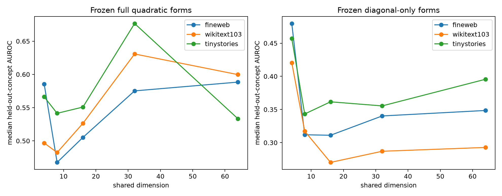

# Layer-17 held-out-concept generalization

The shared basis is frozen from newline, three suffix classes, and all-caps. Nine untouched output predicates are then evaluated. A separately constructed held-out-form basis is reported only as an oracle comparison; no corpus activations are used to construct either basis.

## Locked hypotheses

- **H1_frozen_shared4_transfer: not supported.**
- **H2_frozen_shared32_transfer: supported.**
- **H3_frozen_weight_coverage: not supported.**
- **H4_heldout_cross_terms: supported.**
- **H5_basis_universality: supported.**

| Corpus | Eligible concepts | Full AUROC | Frozen 4D | Held-out-basis 4D | Frozen 32D | Diagonal-only 32D |
|---|---:|---:|---:|---:|---:|---:|
| fineweb | 8 | 0.577 | 0.585 | 0.539 | 0.575 | 0.340 |
| wikitext103 | 8 | 0.649 | 0.497 | 0.480 | 0.631 | 0.287 |
| tinystories | 3 | 0.441 | 0.566 | 0.168 | 0.677 | 0.355 |

Per-concept counts, AUROCs, and weight-space coverage are in `layer17_heldout_concepts.json`.
