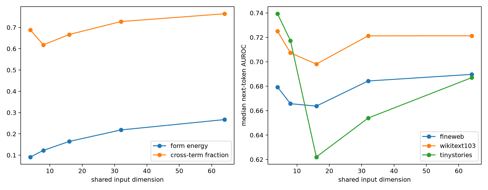

# Layer-17 joint quadratic-form analysis

The five output classes are treated as a family of quadratic forms rather than as owners of separate eigenspaces. A shared basis is learned from the leading eigenspace of the sum of normalized squared forms; every class retains its own coefficient matrix inside that basis.

## Locked hypotheses

- **J1_form_independence: supported.**
- **J2_shared_input_geometry: supported.**
- **J3_noncommuting_forms: supported.**
- **J4_compact_shared_subspace: supported.**
- **J5_semantic_retention: supported.**
- **J6_cross_terms_required: supported.**

Form Gram effective rank: **4.76**. Median normalized commutator: **0.059**. Rank-4 subspace overlap is **0.154**, versus random expectation **0.0035**.

| Shared dimension | Median form energy | Median cross-term fraction | FineWeb AUROC | WikiText AUROC | TinyStories AUROC |
|---:|---:|---:|---:|---:|---:|
| 4 | 0.091 | 0.688 | 0.679 | 0.725 | 0.739 |
| 8 | 0.122 | 0.618 | 0.666 | 0.707 | 0.717 |
| 16 | 0.164 | 0.667 | 0.664 | 0.698 | 0.622 |
| 32 | 0.218 | 0.728 | 0.684 | 0.721 | 0.654 |
| 64 | 0.267 | 0.764 | 0.690 | 0.721 | 0.687 |

Matrices, per-category energy, and AUROCs are in `layer17_joint_forms.json`.
