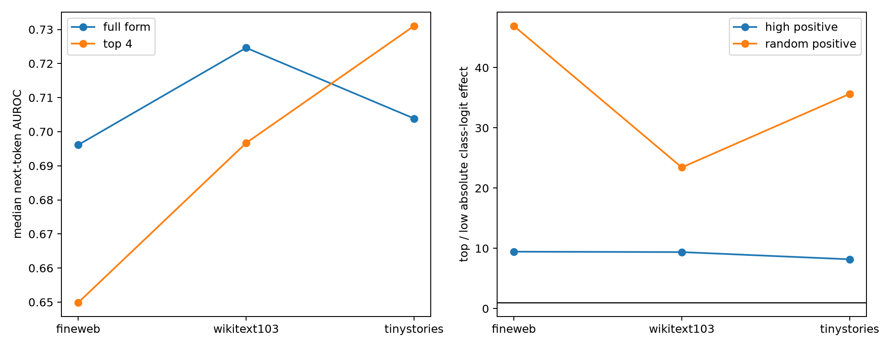

# Layer-17 output-conditioned spectral pilot

For each output token class, this constructs the exact pre-final-norm quadratic form of the final bilinear MLP along that class's unembedding contrast. It evaluates rank-4 semantic prediction and finite input-subspace interventions on FineWeb, WikiText-103, and TinyStories.

## Locked hypotheses

- **L1_compact_semantic_readout: supported.**
- **L2_high_positive_causal_specificity: supported.**
- **L3_random_positive_causal_specificity: supported.**
- **L4_category_consistency: supported.**
- **L5_distribution_transfer: not supported.**

| Corpus | Median full-form AUROC | Median top-4 AUROC | High-positive top/low effect | Random-positive top/low effect |
|---|---:|---:|---:|---:|
| fineweb | 0.696 | 0.650 | 9.45× | 46.92× |
| wikitext103 | 0.725 | 0.697 | 9.38× | 23.44× |
| tinystories | 0.704 | 0.731 | 8.18× | 35.65× |

The quadratic form is exact only before the final residual addition, RMSNorm, and logit tanh. The finite intervention recomputes all of those operations. Per-category AUROCs and effects are in `layer17_output_spectra.json`.
