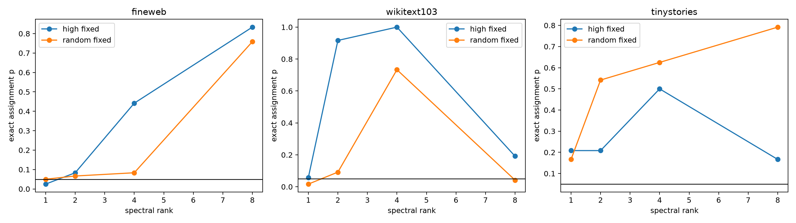

# Layer-17 rank-specificity sweep

The rank-4 category assignment failed despite strong top-versus-low effects. This sweep tests whether the leading individual mode is category-specific while additional high-magnitude modes form a shared output-control subspace.

## Locked hypotheses

- **RS1_rank1_assignment: not supported.**
- **RS2_rank1_row_wins: not supported.**
- **RS3_rank1_improves_rank4: supported.**
- **RS4_random_positive_rank1: not supported.**
- **RS5_natural_rank1: not supported.**

| Corpus | Rank | High fixed p | High row wins | High natural p | Random fixed p |
|---|---:|---:|---:|---:|---:|
| fineweb | 1 | 0.0250 | 1 | 0.0833 | 0.0500 |
| fineweb | 2 | 0.0833 | 2 | 0.0667 | 0.0667 |
| fineweb | 4 | 0.4417 | 2 | 0.0500 | 0.0833 |
| fineweb | 8 | 0.8333 | 1 | 0.0917 | 0.7583 |
| wikitext103 | 1 | 0.0583 | 1 | 0.0917 | 0.0167 |
| wikitext103 | 2 | 0.9167 | 1 | 0.4083 | 0.0917 |
| wikitext103 | 4 | 1.0000 | 1 | 0.4500 | 0.7333 |
| wikitext103 | 8 | 0.1917 | 2 | 0.0167 | 0.0417 |
| tinystories | 1 | 0.2083 | 1 | 1.0000 | 0.1667 |
| tinystories | 2 | 0.2083 | 1 | 0.6667 | 0.5417 |
| tinystories | 4 | 0.5000 | 1 | 0.2500 | 0.6250 |
| tinystories | 8 | 0.1667 | 1 | 0.0417 | 0.7917 |

All matrices and per-site rank sweeps are in `layer17_rank_specificity.json`.
